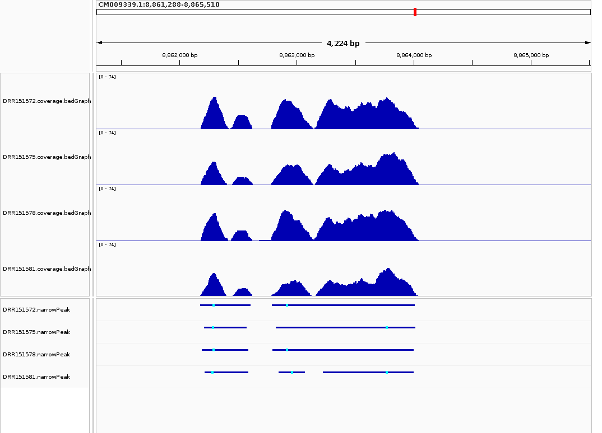
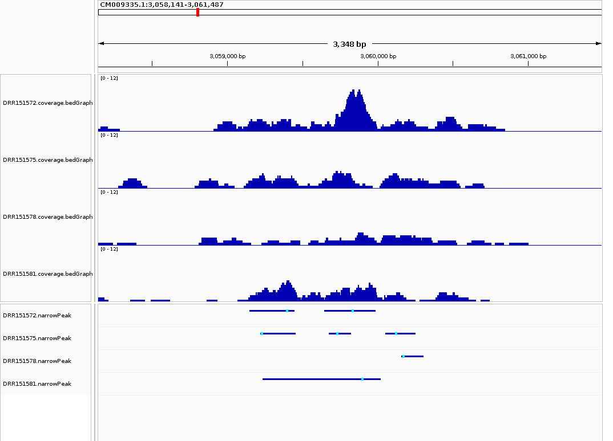

# Week 10: H3K4me3 peak calls in Physcomitrium patens

This analysis adapts the Week 9 design-driven workflow for ChIP-seq: downloading, trimming, and alignment are retained, while variant calling is replaced by MACS3 peak calling. The organism and reference are unchanged: *Physcomitrium patens* (formerly *Physcomitrella patens*), Phypa V3, GCA_000002425.2.

## Project and design

[BioProject PRJDB7369](https://www.ebi.ac.uk/ena/browser/view/PRJDB7369) studies histone modifications during STEMIN1 induction in moss gametophores. The selected assay is **H3K4me3 ChIP-seq** in the GX6:STEMIN1-Myc line. **DMSO** is the vehicle control; **estradiol** induces STEMIN1. There are **two biological replicates per condition**, plus a matched total-H3 ChIP background for each replicate: eight single-end libraries in total.

| Group | Replicate | H3K4me3 signal | Matched total-H3 background |
|---|---:|---|---|
| DMSO | 1 | DRR151572 | DRR151571 |
| DMSO | 2 | DRR151578 | DRR151577 |
| Estradiol | 1 | DRR151575 | DRR151574 |
| Estradiol | 2 | DRR151581 | DRR151580 |

`design.csv` contains the run IDs, groups, replicate numbers, signal/background roles, raw-read URLs, file sizes, and read limits. Only H3K4me3 signal libraries receive peak calls; total-H3 libraries provide the background against which enrichment is tested. The H3 background is distinct from the DMSO biological control.

To keep this exercise manageable, each library uses its **first 2 million reads**. This is deterministic prefix sampling, not random sampling or the full published dataset. The [original study](https://doi.org/10.1038/s41477-019-0464-2) provides biological context; this exercise does not reproduce all of its analyses or conclusions.

Start with this README, `design.csv`, and the commented `Makefile`. The two files in `scripts/` implement the workflow; `results/` contains the saved peaks, summaries, and screenshots.

## How this adapts the earlier workflow

| Earlier variant workflow (Week 9) | Peak workflow (Week 10) |
|---|---|
| Process one sample | `make sample SAMPLE=DRR151572` processes one signal and its matched H3 background |
| Read samples from `design.csv` | The design adds condition, replicate, signal/background role, and a matched background ID |
| Run all samples with `make batch` | `make batch` runs the design and produces the peak summaries |
| Call variants in each BAM | Call H3K4me3 peaks in each signal BAM against its matched background |
| Merge sample VCFs | Retain separate replicate peak files and calculate within-group overlap |
| Review variants in IGV | Compare coverage and peak intervals in agreeing and disagreeing regions |

The earlier instruction to merge VCFs applies to Week 9. Week 10 replaces variant calling with peak calling, so its outputs are peak intervals and replicate comparisons. The Week 9 samples are whole-genome sequencing libraries; this assignment uses a ChIP-seq BioProject while retaining the same organism and reference.

## Run the workflow

Use Linux/WSL with GNU Make, GNU Parallel, Python 3.11 or newer, BWA, SAMtools, BEDTools, cutadapt, and MACS3 on `PATH`. The workflow does not install software. The tested peak caller is MACS3 3.1.0 and the trimmer is cutadapt 5.2; their versions can be installed with `python3 -m pip install macs3==3.1.0 cutadapt==5.2` in an isolated environment. Exact tool versions used for the saved results are recorded in `results/versions.json`.

```bash
git clone https://github.com/Bismarkacquah/BMB852.git
cd BMB852/Week-10
make help
make check
make dry-run JOBS=2
make sample SAMPLE=DRR151572
make batch JOBS=2 THREADS=4
```

GNU Parallel runs up to two per-sample Make jobs concurrently, with four threads supplied to trimming/alignment in each job. Use `JOBS` for the number of simultaneous libraries and `THREADS` for threads per library; start with `JOBS=2 THREADS=4` on an eight-core machine. Invoke batch with a single parent Make process to keep this concurrency limit clear. `make batch` downloads the reference and read subsets, trims reads, aligns and filters them, calls peaks, and writes replicate summaries. The raw data and reference are downloaded automatically; no earlier-week files are required. The saved run reused a verified local copy of the same reference and indexes, while all eight selected ChIP-seq libraries were processed for this assignment. The initial run needs several GB of working space and can take substantial time depending on downloads and alignment hardware.

| Command | Purpose |
|---|---|
| `make design` | Reconstruct the selected moss libraries from ENA metadata |
| `make batch JOBS=2` | Dispatch the design with GNU Parallel and summarize peak calls |
| `make dry-run` | Preview all eight per-library commands without processing data |
| `make sample SAMPLE=DRR151572` | Run one signal sample and its matched background |
| `make samples` | List the library IDs in the design |
| `make check` | Validate the design and check installed tools |
| `make background` | Process the four total-H3 libraries |
| `make peaks` | Process all libraries and call four H3K4me3 peak sets |
| `make report` | Summarize peak counts, overlap, and review regions |
| `make igv` | Load coverage and peaks in IGV and save the two screenshots |

Rerun the same command after resolving an error; completed targets are reused when their inputs and settings have not changed. For a separate run, supply `OUT=output-fresh` consistently to every command. Per-sample FASTQ/BAM files, coverage tracks, and logs are local under `output/` and are excluded from Git. Core peak files and small summary files are saved under `results/`.

## Design-file and parallel-execution notes

Each row of `design.csv` is one unique library. `sample_id` is the run accession, `group` identifies DMSO or estradiol treatment, `replicate` is numeric, `role` distinguishes signal from background, and `background` links a signal to its matched H3 library. Each column records one attribute.

Categorical labels use letters, numbers, underscores, or hyphens and begin with a letter. Thus the machine-readable organism is `Physcomitrium_patens` and the assay label is `ChIP_seq`. Read counts and file sizes are numeric fields. Download URLs retain normal URL punctuation. Empty background fields are intentional for background libraries.

### Recreate the design from source metadata

The two identifying accessions are **PRJDB7369** for the ChIP-seq BioProject and **GCA_000002425.2** for the Phypa V3 reference assembly. The sequencing runs have DRR accessions, as listed in the sample table above.

The committed design can be rebuilt directly from ENA:

```bash
make design
```

This retrieves the project's run metadata, selects single-end H3 and H3K4me3 libraries with DMSO/estradiol treatments and replicates 1/2, and matches backgrounds by treatment and replicate. H3K27me3 libraries in the same project are excluded. The builder checks that every source library contains at least the requested 2 million reads and that all eight expected treatment/replicate/mark combinations are present. It reproduced the submitted CSV byte for byte during verification. If the design is unchanged, its timestamp is preserved so rebuilding metadata does not trigger unnecessary analysis.

Run `make design` separately from analysis targets. Plain `make` displays help. For a first computational check, run the single-sample command above before `make batch`; the batch reuses that completed signal/background pair. This follows the course's single-sample-to-batch progression while using the moss data.

The Makefile follows the course GNU Parallel pattern, using `--colsep , --header : --eta --lb -j $(JOBS)`. The helper reads the full CSV with Python's CSV parser and emits the safe dispatch columns `sample_id,group,replicate`. This keeps URL and descriptive metadata out of shell command construction.

`batch` first prepares the shared reference/indexes and settings, runs the four background rows, and then runs the four signal rows. Each dispatched command calls the same per-library Make targets. All backgrounds finish before signals start, so a background can be reused safely. `--halt soon,fail=1` stops scheduling new work if a job fails; job logs are saved under `output/`.

```bash
make dry-run JOBS=2
make batch JOBS=2 THREADS=4
```

The saved peak calls and screenshots were generated with the original Make-based scheduler. The GNU Parallel dispatcher was added afterward and verified with command previews and an isolated execution check; the scientific processing commands, run accessions, read limits, and group assignments are unchanged. The saved-run verification records the original and reformatted design checksums.

## Processing notes

Cutadapt removes the Illumina adapter, trims low-quality 3-prime ends at quality 20, and retains reads at least 25 bases long. BWA MEM aligns against the same reference as Week 9, using a fixed input batch size. SAMtools removes coordinate duplicates; only primary mapped alignments with MAPQ >=20 remain.

[MACS3](https://macs3-project.github.io/MACS/docs/callpeak.html) uses each signal library and its matched H3 background with `-f BAM --nomodel --extsize 150 --keep-dup all -q 0.05`. Duplicates have already been removed, so MACS3 retains the remaining alignments. The 150-bp fragment extension is a fixed assumption for these single-end libraries, not a fragment-size estimate. Narrow peak calling is used for H3K4me3. The effective genome size is approximated as 330 million bases (about 70% of the 471.85-Mb reference); it is not a measured mappability value.

Coverage tracks show aligned-read coverage scaled per million retained reads, without fragment extension. Their heights therefore are not identical to the extended-fragment signal used by MACS3. Peak coordinates use BED's zero-based, half-open convention; IGV displays genomic positions starting at one.

## Peak counts and replicate consistency

| Sample | Group | Replicate | Input reads | Retained reads | Peaks |
|---|---|---:|---:|---:|---:|
| DRR151572 | DMSO | 1 | 2,000,000 | 1,732,882 | 28,615 |
| DRR151575 | Estradiol | 1 | 2,000,000 | 1,695,701 | 26,742 |
| DRR151578 | DMSO | 2 | 2,000,000 | 1,680,499 | 25,433 |
| DRR151581 | Estradiol | 2 | 2,000,000 | 1,731,135 | 25,660 |

Retained reads are primary alignments after coordinate-duplicate removal and MAPQ filtering. These counts use the selected read prefixes, not the full libraries.

A peak is counted as supported when it overlaps a peak in the other replicate by at least 50% of **both** intervals. This is a descriptive overlap measure, not IDR or a differential-enrichment test.

| Group | Replicate 1 peaks supported by replicate 2 | Replicate 2 peaks supported by replicate 1 |
|---|---:|---:|
| DMSO | 10,906/28,615 (38.1%) | 10,906/25,433 (42.9%) |
| Estradiol | 11,568/26,742 (43.3%) | 11,568/25,660 (45.1%) |

Under this criterion, agreement within each group is partial. Differences in the two percentages reflect differences in peak-set size and boundaries. They should be read alongside the local coverage evidence below.

## IGV comparison

The following regions were selected from the DMSO peak calls. Each view contains four coverage tracks (reads per million retained alignments) and four peak tracks, with run accessions matching the design table.

### Replicates agree: CM009339.1:8,861,288-8,865,510



The selected DMSO replicate 1 peak at **CM009339.1:8,862,789-8,864,010** has a peak in DMSO replicate 2 with at least 50% reciprocal overlap. Compare both coverage profiles and the peak intervals to assess local agreement.

### Replicates disagree: CM009335.1:3,058,141-3,061,487



The selected DMSO replicate 1 peak at **CM009335.1:3,059,642-3,059,987** has **no overlapping peak call** in DMSO replicate 2. This is disagreement in the called intervals; it does not imply that replicate 2 has no reads or that the mark is biologically absent.

To regenerate them, install IGV 2.19.8 with its bundled Java 21 and use a working display:

```bash
export IGV_DIR=/absolute/path/to/IGV_Linux_2.19.8
make igv
```

`make igv` loads the four normalized coverage tracks and the four peak files against the same reference. Track filenames identify the run accessions in the design table. The generated batch and session are saved in the run's output directory with paths for that checkout.

The [saved-run verification](results/validation.json) records the final BAM, peak-file, and screenshot checks. [Software versions and settings](results/versions.json) describe the execution environment.

## Interpretation limits

Peak counts depend on sequencing depth, duplicate removal, the background library, and peak-calling settings. Failure to call a peak does not prove that the histone mark is absent. A difference between replicates may reflect sampling or a threshold crossing rather than a biological change. The two regions illustrate agreement and disagreement within a group; they do not establish differential enrichment between DMSO and estradiol. That would require a count-based differential analysis, appropriate normalization, and further quality checks on the full libraries.
