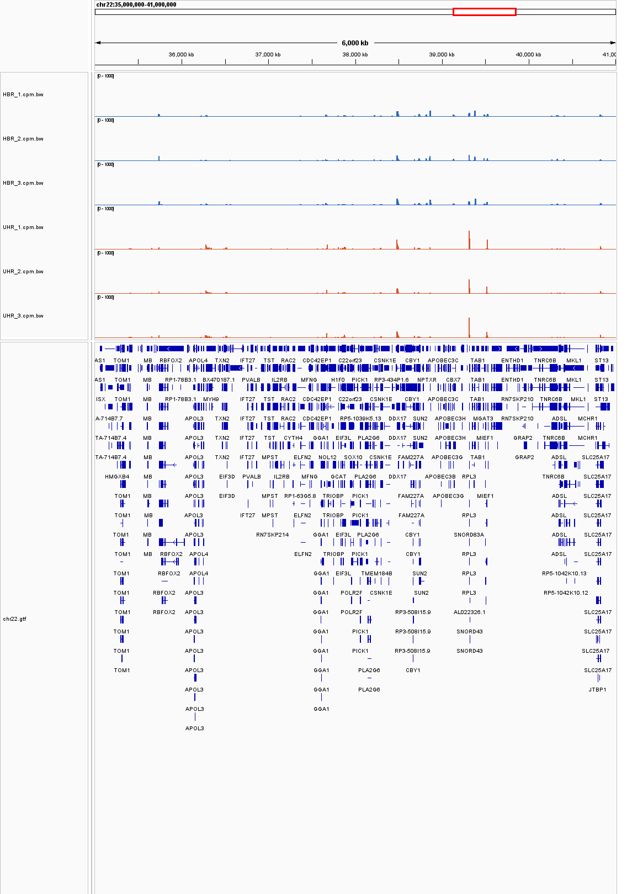
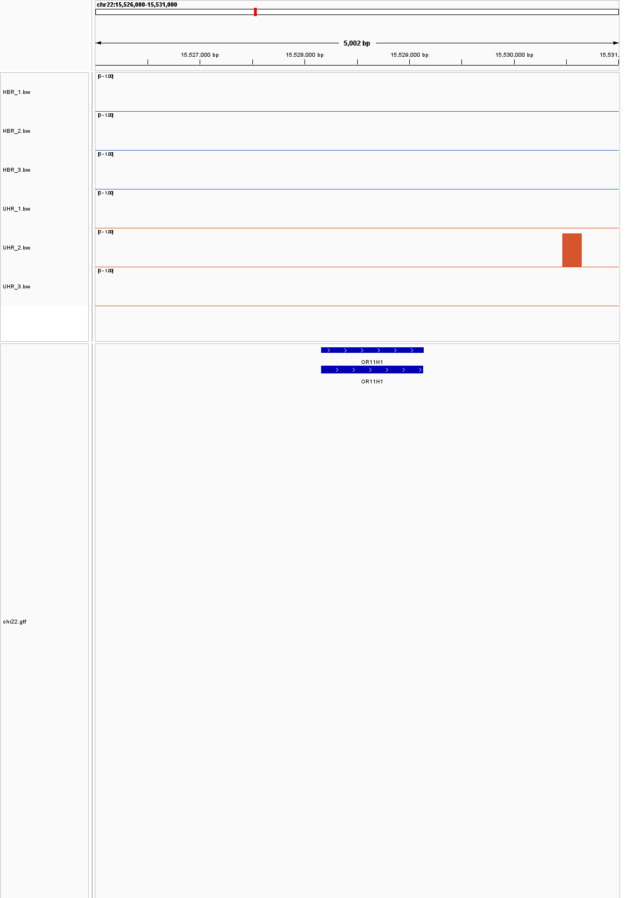
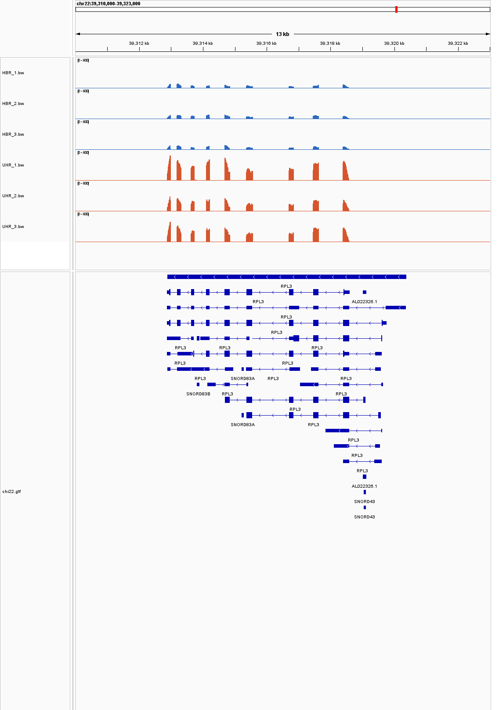
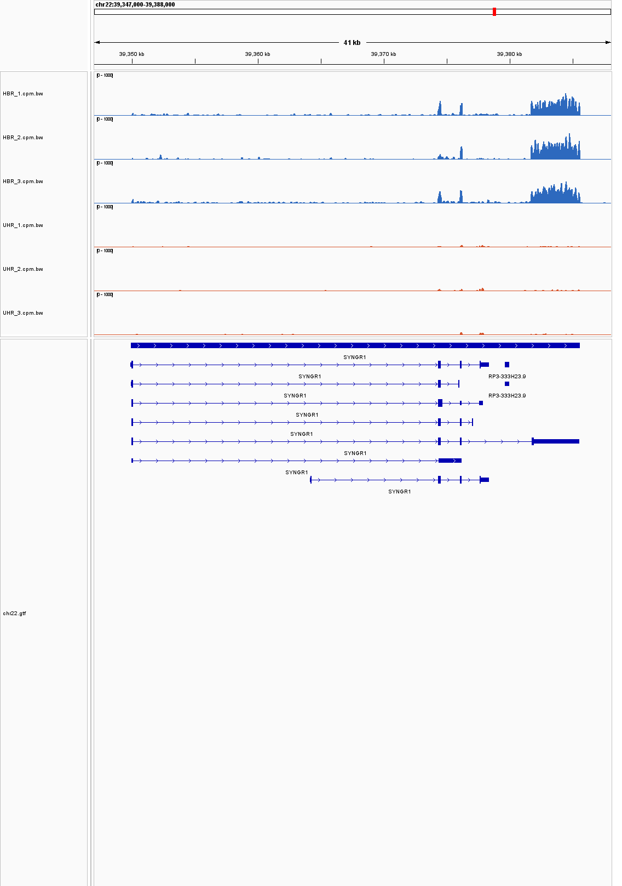

# Week 11: Evaluate gene expression coverages

I compared three **Human Brain Reference (HBR)** samples with three **Universal Human Reference (UHR)** samples. HBR contains brain RNA; UHR contains RNA pooled from ten cancer cell lines.

Following the [genome-based RNA-seq tutorial](https://www.biostarhandbook.com/courses/2026/appbio/rnaseq/rnaseq-genome/), I aligned all six samples with HISAT2 and generated coverage files with bamCoverage. In IGV, I loaded **`chr22.genome.fa`**, all six coverage tracks, and **`gtf/chr22.gtf`**. **HBR is blue; UHR is orange**, with matching colors for replicates and a common y-axis scale. I also generated CPM-normalized tracks to account for different mapped library sizes. Numerical values below were checked in the coverage files at visually selected loci.

## 1. How are the sample types different across a wide region?

Across **chr22:35,000,000–41,000,000**, the groups share many peak locations but differ in relative peak heights. UHR has prominent peaks around RPL3 and nearby genes; HBR has stronger SYNGR1 coverage on closer inspection. These differences remain after CPM normalization.

## 2. How consistent are the replicates?

Within each group, peaks generally occur at the same positions across the inspected regions, although heights vary. At the selected SYNGR1 interval, HBR coverage ranges from **274.6–313.9 CPM**, compared with **8.1–9.7 CPM** in UHR. The between-group difference is much larger than the variation within either group.

## 3. Which gene is not expressed?

**OR11H1**, at **chr22:15,528,158–15,529,139**, has **zero coverage across its annotated gene interval in all six samples**. A small UHR_2 signal lies downstream, outside the gene. This means no detectable expression in these data.

## 4. Which gene is strongly expressed in every sample? What is its coverage?

**RPL3**, at **chr22:39,312,882–39,320,389**, has strong exon coverage in all samples. Its maximum raw per-base depths are:

| Group | Replicate 1 | Replicate 2 | Replicate 3 |
| --- | ---: | ---: | ---: |
| HBR | 100 | 97 | 103 |
| UHR | 564 | 330 | 453 |

These are peak depths, not average gene expression.

## 5. Can the expressed transcripts be identified?

HBR coverage supports **SYNGR1-001 (ENST00000328933.9)**, including its long terminal exon at **chr22:39,381,696–39,385,588**. Shorter annotated transcripts cannot alone explain this downstream coverage. However, shared exons make some isoforms ambiguous, so coverage alone cannot establish that this is the only expressed transcript.

## 6. Which gene/transcript differs, and what is the fold change?

The SYNGR1 terminal-exon interval **chr22:39,382,500–39,383,500** has the following average normalized coverage:

| Group | Replicate 1 | Replicate 2 | Replicate 3 | Group mean |
| --- | ---: | ---: | ---: | ---: |
| HBR (CPM) | 274.6 | 313.9 | 312.8 | 300.5 |
| UHR (CPM) | 9.7 | 8.1 | 8.6 | 8.8 |

**HBR/UHR fold change ≈ 300.5 ÷ 8.8 ≈ 34-fold.** This is an exon-coverage estimate using normalization within the chr22 subset, not a full-transcript abundance estimate.

## 7. Is it upregulated or downregulated?

The SYNGR1 terminal-exon signal is **upregulated in HBR relative to UHR**, by approximately 34-fold. This compares two RNA sources rather than a treatment response.

## 8. How certain is the difference, and why?

The difference is convincing in these tracks: all three HBR replicates exceed all three UHR replicates, the signal extends across the exon, and it persists after normalization. It is therefore unlikely to be a small random coverage fluctuation. However, visual inspection does not establish statistical significance; a count-based analysis and confirmed replicate design would be needed. These pooled-reference replicates should not automatically be treated as independent human donors.
