# Homework Assignment 7: Generate a VCF file

For this assignment, I continued with the moss data from Week 5 and added
variant calling to the alignment workflow. I first used the original
1,000-pair subset, but the reads were too sparse to support any calls after
filtering. I then analyzed 20 million read pairs from the same sequencing
run. This gave much better coverage and made it possible to compare the
variant calls with the alignments in IGV.

## Organism and sequencing data

The sample is *Physcomitrium patens*, a moss. Its reference assembly is about
472 Mb, so a small read subset covers only a tiny part of the genome.

| Detail | Value |
|---|---|
| Organism | *Physcomitrium patens* |
| Reference assembly | `GCA_000002425.2_Phypa_V3` |
| Total reference length | 471,852,792 bp |
| Study accession | `PRJEB51295` |
| Experiment accession | `ERX8525940` |
| Run accession | `ERR8982185` |
| Sample accession | `SAMEA13207856` |
| Sample | CRIS1#1; Switzerland Gransden cultivar |
| Tissue | Protonema grown for seven days |
| Sequencing | Paired-end whole-genome sequencing; Illumina NovaSeq 6000 |

The identifiers are saved in [run-metadata.tsv](provenance/run-metadata.tsv)
and linked through the [ENA run record](https://www.ebi.ac.uk/ena/browser/view/ERR8982185).
The [sample record](https://www.ebi.ac.uk/ena/browser/view/SAMEA13207856)
describes CRISPR-Cas9 transformation. That background is useful, but this
analysis does not determine which differences, if any, were caused by editing.

## Changes to the Week 5 Makefile

The [Week 5 Makefile](../Week-5/Makefile) now has a `variants` target that
builds the BAM when needed and calls the [Week 7 Makefile](Makefile).
The [expanded Makefile](expanded/Makefile) repeats the analysis with the
larger read subset. I kept the same reference, trimming settings, and
calling thresholds so the two runs could be compared.

The added steps are:

1. Calculate genotype likelihoods from the BAM with `bcftools mpileup`.
2. Call SNPs and indels with `bcftools call -mv`.
3. Normalize the calls against the reference and check the reference alleles.
4. Label low-quality or low-depth calls and create a separate PASS VCF.
5. Index the VCFs and generate statistics and a summary report.

This is the calling command from the expanded workflow:

```bash
bcftools mpileup -Ou \
  -f ../../Week-5/fasta/GCA_000002425.2_Phypa_V3_genomic.fna \
  -q 20 -Q 20 -d 1000 -a FORMAT/DP,FORMAT/AD \
  bam/ERR8982185.20M.sorted.bam | \
bcftools call -mv --ploidy 1 -Oz \
  -o results/ERR8982185.20M.raw.vcf.gz
```

Here, `-q 20` excludes reads with mapping quality below 20, and `-Q 20`
excludes bases with base quality below 20. `DP` records usable sample depth,
while `AD` records support for the reference and alternate alleles. The
depth cap is 1,000 reads per input file. I used a haploid model because
protonema belongs to the moss gametophyte stage; the sample record does not
directly measure ploidy. The life stage is described in the
[reference assembly study](https://eprints.whiterose.ac.uk/125770/1/2017_PlantJournal.Lang.online.pdf).

Normalization uses `bcftools norm -f REFERENCE -c e -m -any`. It checks
reference alleles, left-aligns indels, and splits multiallelic records.
The filter labels a call `LowQualOrDepth` when `QUAL < 20` or `DP < 3`.
Calls meeting both thresholds go into the PASS VCF. The calling steps follow
the [BCFtools guide](https://samtools.github.io/bcftools/howtos/variant-calling.html).

## Coverage and variant results

The larger download contained 20,000,000 paired records. After adapter and
quality trimming, 19,977,564 pairs remained. Of the primary reads, 74.31%
mapped and 71.72% were properly paired.

| Measure | Original subset | Expanded subset |
|---|---:|---:|
| Trimmed read pairs | 997 | 19,977,564 |
| Reference covered at MAPQ >= 20 | 0.0399% | 96.4835% |
| Mean depth across the reference | 0.000418 | 8.4184 |
| Raw candidate variants | 134 | 32,651 |
| PASS variants | 0 | 24,042 |

Both coverage summaries use minimum mapping quality 20 and include uncovered
reference bases. The expanded reads came from ENA, while the original subset
was extracted through SRA. Their first records differ, so these are two
subsets of the same run rather than exactly nested read sets.

### Number and types of variants

| Stage | Total records | SNPs | Indels |
|---|---:|---:|---:|
| Raw calls | 32,651 | 27,494 | 5,157 |
| Normalized calls | 32,651 | 27,494 | 5,157 |
| PASS calls | 24,042 | 19,576 | 4,466 |

Normalization realigned 4,394 records, with no records split or removed for
reference mismatches or duplication. Realignment changes how an indel is
represented; it does not add new variants. Filtering excluded 8,609 records
from the PASS set, leaving 73.63% of the candidates.

Among the PASS calls, **81.42% were SNPs** and **18.58% were indels**.
There were no MNPs, other variant types, or multiallelic sites in this output.
The SNP transition/transversion ratio was 0.97 (9,637 transitions and 9,939
transversions). I would not use that ratio alone to judge this call set;
coverage, mapping, and the sample's differences from the reference also matter.

## Alignment support in IGV

I loaded the reference, BAM, filtered VCF, and PASS VCF in IGV 2.19.8.
The upper tracks show the calls, followed by coverage and aligned reads.
Gray read segments match the reference, colored bases show mismatches,
and purple markers indicate insertions.

For the close-ups, I chose calls with usable depth near 20, QUAL >= 50,
MQ >= 50, at least eight alternate observations, and an alternate fraction
of at least 0.8. I also checked that unfiltered depth at each selected site
was no more than 100. These examples were chosen for inspection and do not
represent the distribution of every call in the VCF.

### Regional view: CM009327.1

This 10-kb view shows reads across most of the interval, along with changes
in depth and a local gap. Most positions have no variant marker because
their aligned bases agree with the reference. The larger input improved
coverage without making every covered position a variant.

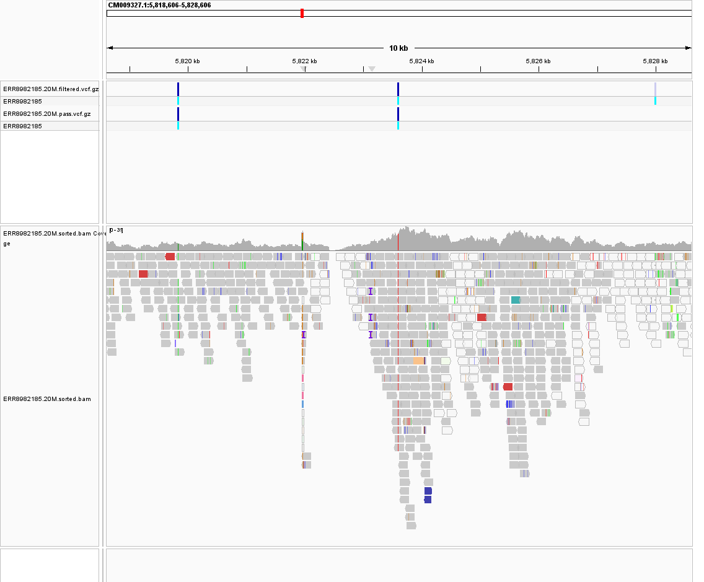

### SNP 1: CM009327.1:5,823,606, A>T

This call has QUAL 225.417, DP 20, and AD 0,20. All 20 usable observations
support T. The red T bases form a consistent column beneath the VCF marker,
with reads starting and ending at different positions. This looks more
convincing than an isolated mismatch in a single read.

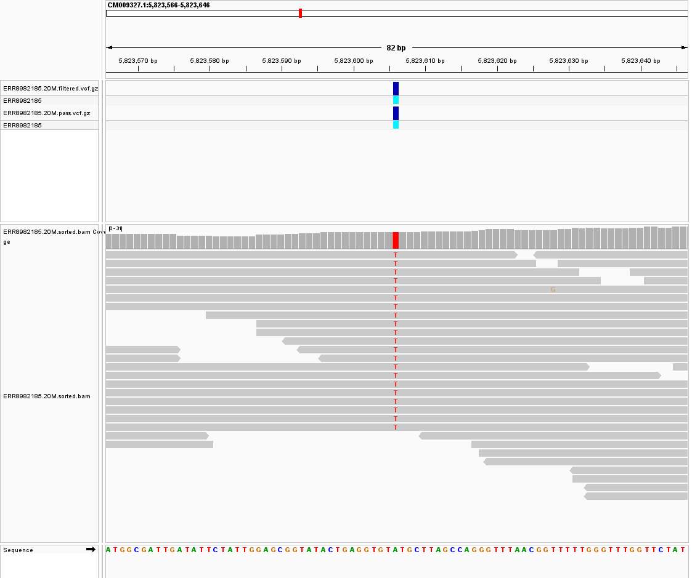

### SNP 2: CM009317.1:24,015,889, A>G

The orange G bases line up with the called position. QUAL is 225.417,
DP is 20, and AD is 0,20, again showing consistent alternate support.
Both SNP examples have MQ 60. The selected calls and their measurements
are saved in [igv-selected-variants.json](expanded/results/igv-selected-variants.json).

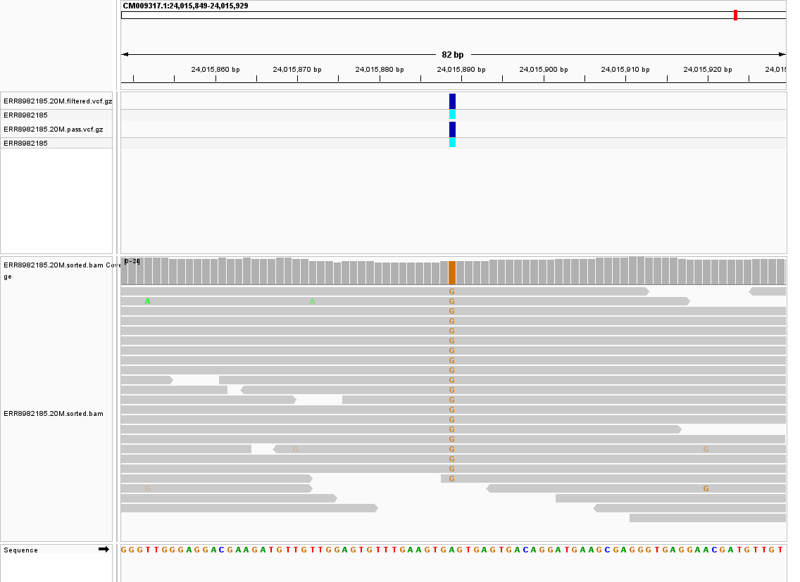

### Insertion: CM009327.1:9,842,294, A>AT

The purple markers show a one-base insertion at the same position in many
reads. QUAL is 228.361, DP is 20, and AD is 2,18, so 18 usable observations
support the insertion and two support the reference. The repeated bases
nearby make alignment inspection especially useful for this example.

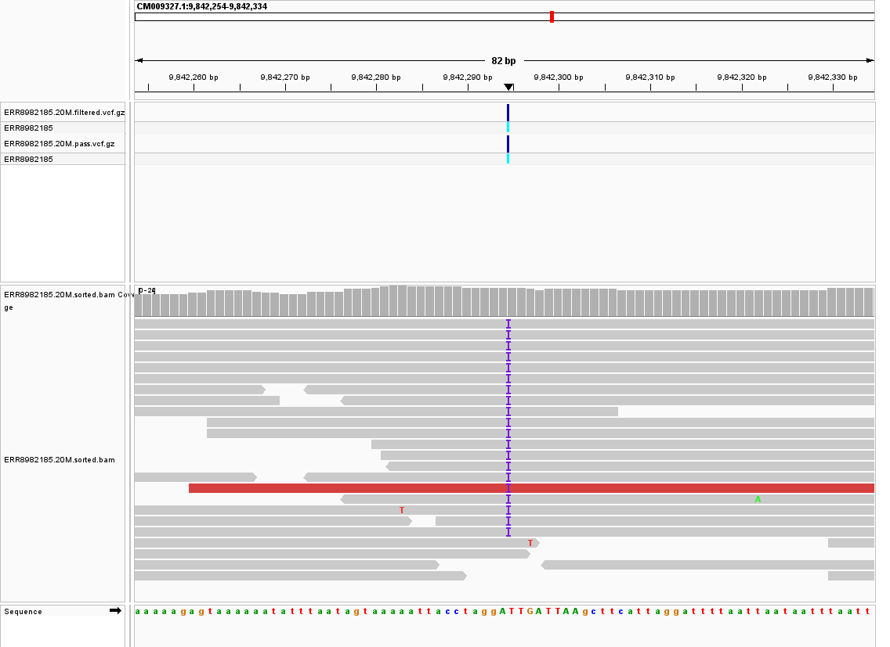

## Revisiting the original examples

The earlier A>G candidate at `CM009322.1:3,189,512` now passes with DP 917
and AD 0,917. The T>A candidate at `CM009334.1:8,569,458` also passes, with
DP 970 and AD 3,967. These depths are much higher than the genome average,
so they need closer examination for repeats, mapping ambiguity, and duplicate
reads. High depth alone does not settle whether a call is reliable.

### Original SNP cluster with more reads

The wider view now contains a dense pileup beneath the VCF markers. It is
a clear visual contrast with the sparse original alignment, but this locus
is unusually deep and should not stand in for typical genome coverage.

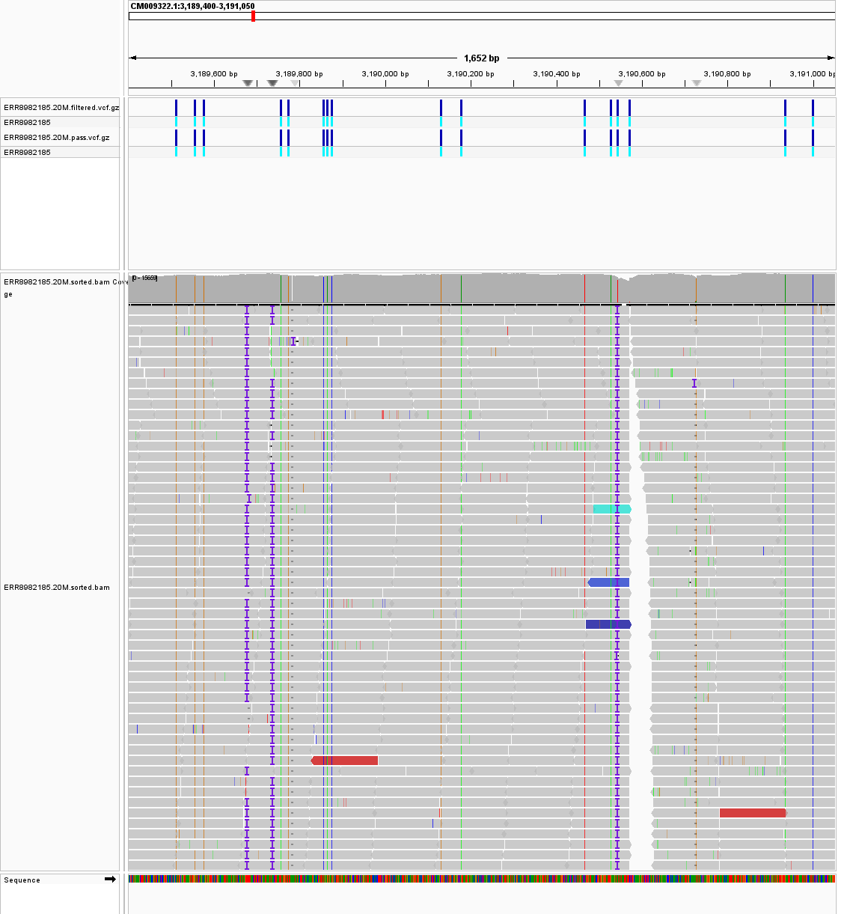

### Original SNP close-up

The orange G bases appear repeatedly beneath the original A>G call. This
provides much more usable support than the two observations in the first
run, while the unusually high depth remains a reason to check mapping.

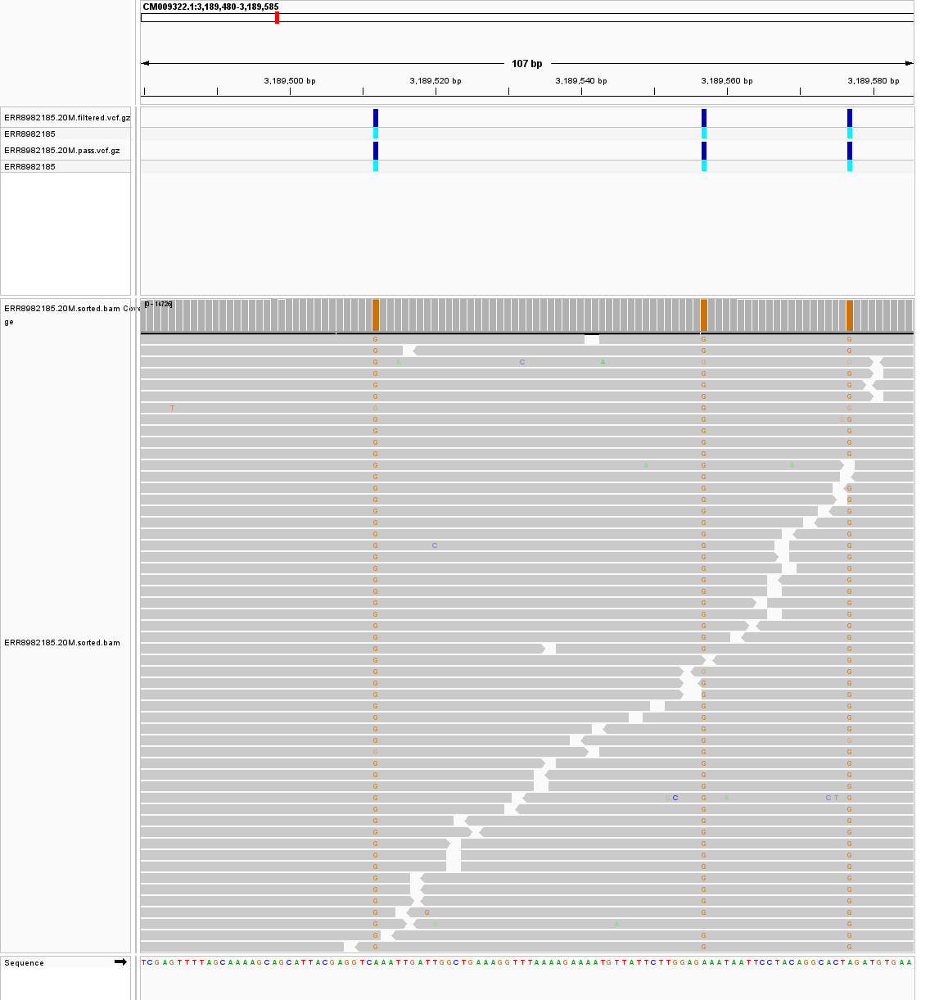

### Original insertion region

Purple insertion markers remain visible in some reads, but the earlier
`CM009336.1:3,474,356 A>AAAT` call is absent from the expanded VCF in the
inspected interval. Nearby SNPs were called instead. The image therefore
shows an alignment feature that was not reported as that insertion by the
expanded workflow. The calls at the original loci are listed in
[original-loci-variants.tsv](expanded/results/original-loci-variants.tsv).

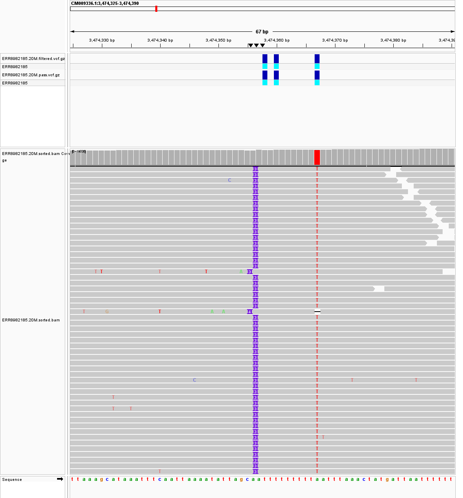

## Discussion

The main change was the amount of usable evidence. In the first run, each
candidate had only one or two usable observations, so all 134 candidates
failed the minimum depth of three. Some had fairly high QUAL scores, but
they still had too little read support. The empty PASS VCF therefore said
more about the small input than about whether the sample matched the reference.

With the larger subset, coverage reached 96.48% and mean depth reached 8.42.
That allowed many more positions to be assessed and produced 24,042 calls
meeting the same thresholds. SNPs made up most of the passing calls, with
indels accounting for nearly one fifth. The selected IGV examples show
consistent alternate bases or insertion markers across several reads,
which makes them reasonable candidates for further investigation.

The deeper data also showed why high depth needs careful interpretation.
The maximum depth was 24,408, far above the genome-wide average. Repeated
sequence, reads mapping to similar regions, and duplicate reads are possible
contributors, but this analysis does not establish the cause of that peak.
Duplicates were not marked or removed. A large pileup can therefore provide
many observations without the same number of independent DNA molecules.

Two earlier SNPs now pass: A>G at `CM009322.1:3,189,512` and T>A at
`CM009334.1:8,569,458`. However, their usable depths of 917 and 970 are
unusually high, so I would examine mapping and duplication before treating
them as especially reliable. The earlier three-base insertion at
`CM009336.1:3,474,356` was not reported in the expanded VCF around that locus,
even though insertion markers remain visible in some reads. That disagreement
shows why a visible mismatch or insertion should be checked against the caller's
usable evidence rather than accepted from the image alone.

Overall, the larger input made the assignment much more informative, but
PASS is still a filtering result. These calls may include real sample-reference
differences and alignment or sequencing errors. Gene annotation, a check of
strand support and duplicates, and independent validation would help identify
the strongest biological candidates. The present results do not establish
that any particular call is a CRISPR edit.

## VCF statistics and graphs

### Run the statistics report

The expanded Makefile saves reports from `bcftools stats` for both raw and
PASS calls. From `Week-7/expanded`, run:

```bash
make stats
awk '$1 == "SN"' results/pass.stats.txt
```

The main counts from the PASS report are:

```text
number of samples:                   1
number of records:               24042
number of SNPs:                  19576
number of MNPs:                      0
number of indels:                 4466
number of others:                    0
number of multiallelic sites:         0
```

The complete [PASS statistics](expanded/results/pass.stats.txt),
[raw statistics](expanded/results/raw.stats.txt), and
[summary](expanded/results/summary.json) are included in the repository.

### Graphs from the statistics report

These graphs were generated from the expanded PASS VCF with BCFtools
`plot-vcfstats`. To recreate them from `Week-7/expanded`, run `make plots`.
The commands behind that target are:

```bash
bcftools stats -s - -d 0,1100,1 \
  results/ERR8982185.20M.pass.vcf.gz > results/pass.sample.stats.txt
plot-vcfstats -P -p plots/pass -t ERR8982185_PASS \
  results/pass.sample.stats.txt
```

`-s -` includes the sample's genotype statistics, which are needed for the
depth distribution. `-P` skips the combined PDF and produces image panels.
This uses the [BCFtools plotting workflow](https://samtools.github.io/bcftools/bcftools.html#plot-vcfstats).

**Transitions and transversions by call quality.** SNPs are sorted from
highest to lowest QUAL. The solid line gives the cumulative Ts/Tv ratio;
the dashed line gives the ratio within successive 1% bins. The highest-quality
subset has a higher ratio than the complete set, which ends at about 0.97.
The variation across bins shows why the overall ratio alone is not enough
to judge every call.

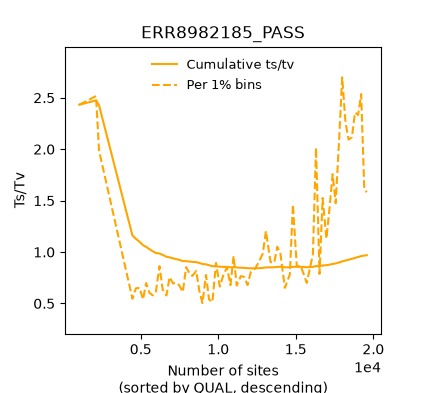

**SNP substitution types.** Each bar counts a reference-to-alternate change.
The darker bars are transitions (A>G, C>T, G>A, and T>C), while the lighter
bars are transversions. These categories sum to 19,576 passing SNPs.

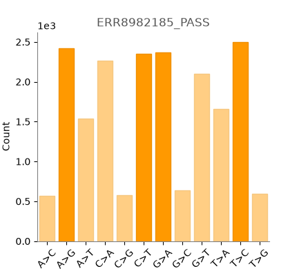

**Indel lengths.** Negative lengths represent deletions and positive lengths
represent insertions. Most calls are short, especially one-base changes.
The longer, less common indels are visible in the tails of the distribution.

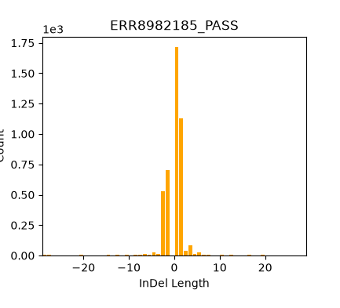

**Depth at passing variant sites.** The black line shows the percentage of
genotypes at each depth, and the orange line shows the cumulative percentage.
About 66.47% have usable depth 3-9, with a long tail of much deeper calls.
The plotting tool displays roughly the first 99% of the depth distribution;
the full values are in [pass.sample.stats.txt](expanded/results/pass.sample.stats.txt).
This is depth at PASS variant sites, not genome-wide coverage, so it should
not be read as a second estimate of the mean genome depth of 8.42.

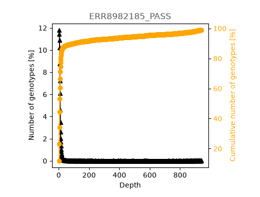

## Reproduce the analysis

Use Linux, macOS, or WSL with Conda. The expanded run needs several GB of
disk space and takes substantially longer than the original small subset.

```bash
git clone https://github.com/Bismarkacquah/BMB852.git
cd BMB852/Week-7
conda env create -f environment.yml
conda activate week7-moss

# Download the Week 5 reference and create its indexes.
make setup
make -C ../Week-5 reference index

# Download, trim, align, call variants, and generate reports.
cd expanded
make all THREADS=4 SORT_THREADS=2
make stats
make validate
make plots
make igv
```

For Windows IGV from WSL, replace the last command with
`make igv IGV_ROOT=C:/path/to/BMB852`. In IGV, choose **Tools > Run Batch Script**
and open `Week-7/expanded/scripts/igv_local_batch.txt`. The generated script
loads the data and saves the screenshots. The BAM needs its `.bai` index,
the reference needs its `.fai`, and each compressed VCF needs its `.tbi`.

To repeat the original small-subset exercise instead, run `make setup`,
`make alignment`, and `make all` from `Week-7`. Its
[candidate VCF](results/ERR8982185.vcf), [statistics](results/raw.stats.txt),
and [four IGV images](screenshots/) are retained for comparison.

## Files and checks

The expanded [filtered VCF](expanded/results/ERR8982185.20M.filtered.vcf.gz)
contains all normalized candidates with their filter labels. The
[PASS VCF](expanded/results/ERR8982185.20M.pass.vcf.gz) contains the accepted
calls. Large FASTQ and BAM files stay local and can be regenerated by Make.

The completed run used BWA 0.7.19, Cutadapt 5.2, Samtools 1.22.1, and BCFtools
1.24. [Tool versions](expanded/provenance/tool-versions.txt) and
[input hashes](expanded/provenance/inputs.sha256) are saved. Validation passed
for BAM integrity, reference agreement of the PASS alleles, and file hashes.
The [validation log](expanded/provenance/validation.log) retains a nonfatal
MQ header warning from BCFtools. The environment file specifies Samtools 1.24
for a fresh install; this run reused the installed tools.

Assignment folder: [Week 7 on GitHub](https://github.com/Bismarkacquah/BMB852/tree/main/Week-7).
