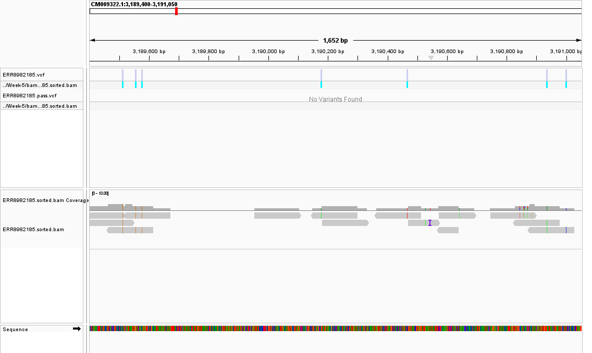
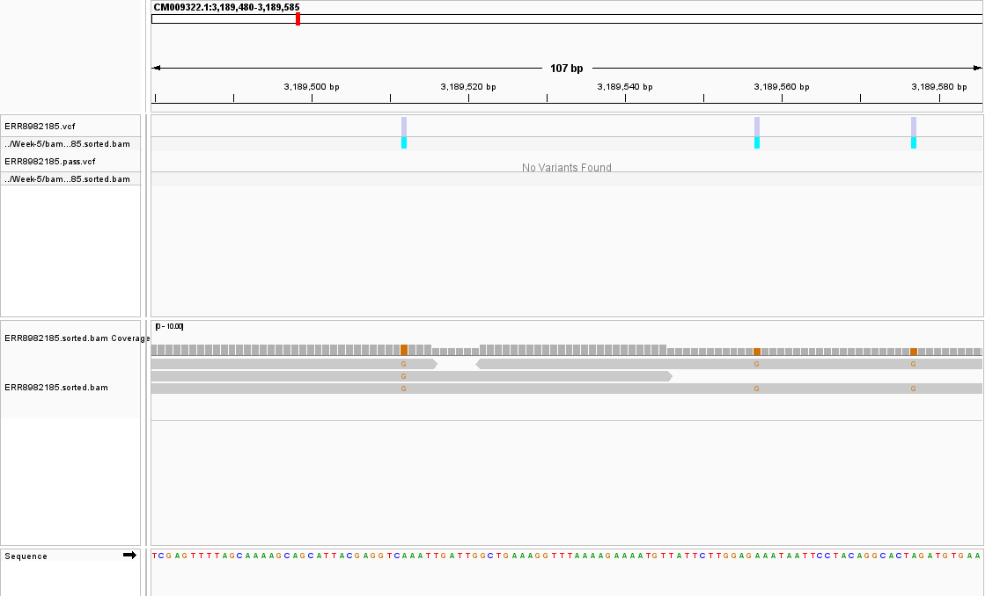
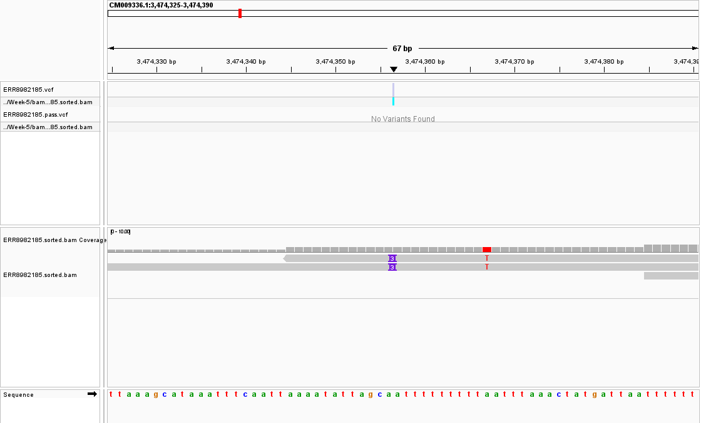
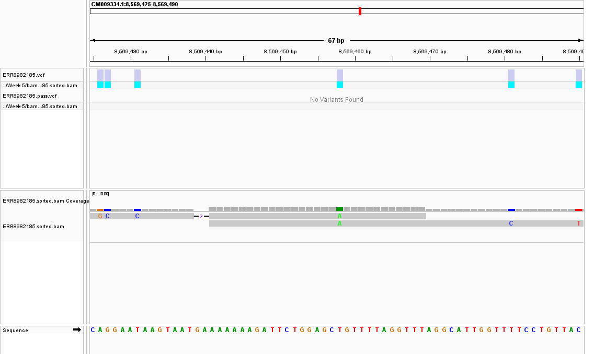

# Week 7: Generate a VCF file

This assignment extends the Week 5 alignment Makefile to call variants from
the coordinate-sorted BAM for *Physcomitrium patens* run `ERR8982185`.
The workflow calculates genotype likelihoods, calls SNPs and indels,
normalizes their representation against the reference, and filters the calls.

## Inputs and provenance

- Reference: `GCA_000002425.2_Phypa_V3`, the same 471,852,792-base assembly used in Week 5.
- BAM: `../Week-5/bam/ERR8982185.sorted.bam`.
- Reads: the first 1,000 paired sequencing spots, trimmed with the Week 5
  settings, leaving 997 pairs and 291,554 bases.
- ENA sample: `SAMEA13207856`, alias `CRIS1#1`, cultivar Switzerland Gransden.

The original BAM was absent from this local checkout and is excluded from
GitHub by Week 5's `.gitignore`. It was regenerated using
`make setup` and `make all` in Week 5. The downloaded reference and annotation
match the checksums in Week 5's `provenance/inputs.sha256`. This is a new
alignment run from the documented subset, not a claim that the BAM bytes
match an unavailable original file.

The [public ENA sample record](https://www.ebi.ac.uk/ena/browser/view/SAMEA13207856)
identifies 7-day protonema tissue and describes CRISPR-Cas9 transformation.
A copy is saved in [provenance/sample.xml](provenance/sample.xml).
I selected `--ploidy 1` because protonema is the haploid gametophyte stage,
as described in the [reference assembly study](https://eprints.whiterose.ac.uk/125770/1/2017_PlantJournal.Lang.online.pdf).
This is an inference from tissue type; the record does not directly measure
this sample's ploidy. `PLOIDY` can be overridden for a different sample.

## Reproduce the analysis

Use Linux, macOS, or WSL. The [environment file](environment.yml) specifies
the required tools. Allow several GB for reference files and BWA indexes.

```bash
git clone https://github.com/Bismarkacquah/BMB852.git
cd BMB852/Week-7
conda env create -f environment.yml
conda activate week7-moss

# Only needed when the Week 5 inputs or BAM are missing:
make setup
make alignment THREADS=2

# Reuse the BAM, call variants, and produce reports:
make all
make summary
make validate
```

Week 5's [Makefile](../Week-5/Makefile) now includes a `variants` target:

```bash
cd ../Week-5
make variants THREADS=2
```

That target builds the BAM and its index if needed, then invokes the
[Week 7 Makefile](Makefile). Input downloads remain an explicit `make setup`
step. Existing BAMs are reused. The main variant-calling command is:

```bash
bcftools mpileup -Ou \
  -f ../Week-5/fasta/GCA_000002425.2_Phypa_V3_genomic.fna \
  -q 20 -Q 20 -d 1000 -a FORMAT/DP,FORMAT/AD \
  ../Week-5/bam/ERR8982185.sorted.bam | \
bcftools call -mv --ploidy 1 -Oz -o results/ERR8982185.raw.vcf.gz
```

`mpileup` calculates genotype likelihoods from aligned bases. `-q 20` and
`-Q 20` exclude low mapping-quality reads and low base-quality observations;
`-d 1000` sets the per-file depth cap. Default BAQ adjustment and read-flag
exclusions remain enabled. `FORMAT/DP` and `FORMAT/AD` record sample depth and
allele depths. `-Ou` streams uncompressed BCF to the next command.
`call -m` uses the multiallelic caller, `-v` retains variant sites, and
`-Oz` saves BGZF-compressed VCF. This follows the
[official BCFtools workflow](https://samtools.github.io/bcftools/howtos/variant-calling.html).

Next, `bcftools norm -f REFERENCE -c e -m -any` checks REF alleles, left-aligns
indels, and splits multiallelic records. A REF mismatch stops the recipe.
`bcftools filter` labels records `LowQualOrDepth` when `QUAL < 20` or the
sample's `FORMAT/DP < 3`. The final VCF contains only `PASS` records.
These are illustrative thresholds for this exercise, not validated discovery
criteria for this sample. Both rejected and accepted calls remain available
in the filtered VCF. Parameters are recorded, and changing them triggers
recalculation on the next Make run.

## Outputs

| File | Purpose |
| --- | --- |
| [Main VCF](results/ERR8982185.vcf) | Readable plain-text VCF with every candidate and its filter label |
| [Raw VCF](results/ERR8982185.raw.vcf.gz) | Candidate variants before normalization and filtering |
| [Normalized VCF](results/ERR8982185.normalized.vcf.gz) | Reference-checked and normalized candidates |
| [Filtered VCF](results/ERR8982185.filtered.vcf.gz) | All normalized calls, with filter labels |
| [PASS VCF](results/ERR8982185.pass.vcf) | Plain-text VCF retaining only accepted calls |
| [Raw statistics](results/raw.stats.txt) | BCFtools counts and variant statistics before filtering |
| [PASS statistics](results/pass.stats.txt) | BCFtools statistics for accepted calls |
| [Summary](results/summary.json) | Counts, depth/quality ranges, and ten highest-QUAL calls |
| [Parameters](provenance/parameters.txt) | Calling and filtering settings |
| [Tool versions](provenance/tool-versions.txt) | Versions actually used |
| [Checksums](provenance/inputs.sha256) | SHA-256 of the BAM, reference, and VCF products |
| [Read-sequence hashes](provenance/trimmed-read-sequences.sha256) | SHA-256 of decompressed trimmed mates, independent of gzip metadata |

In a VCF, `CHROM` and `POS` identify the reference sequence and 1-based
coordinate; `REF` and `ALT` describe the alleles; `QUAL` scores the variant
call; and `FILTER` records applied quality criteria. Sample fields include
`GT` (genotype), `DP` (usable depth), and `AD` (allele depths). With the haploid
model, `GT=1` denotes the first alternate allele. Because Week 5's BAM lacks
read-group sample tags, BCFtools uses its input BAM path as the sample name.

## Findings

The run on **October 11, 2026** produced the following observed results:

| Metric | Result |
| --- | ---: |
| Raw candidate records | 134 |
| SNP records | 130 |
| Indel records | 4 |
| Multiallelic sites | 0 |
| Transitions / transversions | 88 / 42 (ratio 2.10) |
| Candidate sample depth (`FORMAT/DP`) | 1–2 |
| Mean candidate sample depth | 1.052 |
| Candidate QUAL range | 3.22451–80.4149 |
| Records labeled `LowQualOrDepth` | 134 |
| PASS records (`QUAL >= 20` and `FORMAT/DP >= 3`) | **0** |

Normalization retained 134 records. All candidates failed the depth criterion,
including those with high QUAL. The main VCF therefore contains 134 rejected
candidates; the PASS VCF contains the full VCF header and no data rows. This
is a successful workflow result with insufficient read support for passing
calls, not an empty output caused by a failed pipeline.

Examples from the normalized candidates (coordinates are 1-based):

| CHROM | POS | REF | ALT | QUAL | DP | FILTER |
| --- | ---: | --- | --- | ---: | ---: | --- |
| CM009336.1 | 3,474,356 | A | AAAT | 80.4149 | 2 | LowQualOrDepth |
| CM009322.1 | 3,189,512 | A | G | 56.4147 | 2 | LowQualOrDepth |
| CM009334.1 | 8,569,458 | T | A | 48.4146 | 2 | LowQualOrDepth |

The first candidate is a three-base insertion; the next two are SNPs.
These examples illustrate the output, not confirmed biological mutations.
Raw BAM coverage can reach depth 4 while usable candidate depth remains
1–2 because pileup applies quality filters, BAQ, and overlapping-mate handling.

## Validation

The regenerated BAM reproduced Week 5's flag counts and depth statistics,
including 1,513 primary mapped reads and 202,923 covered bases. Records are
saved in [alignment.flagstat.txt](provenance/alignment.flagstat.txt) and
[alignment-depth-summary.json](provenance/alignment-depth-summary.json).
BCFtools 1.24 and Samtools 1.22.1 (both using HTSlib 1.24) were used for the
recorded run. The environment file pins Samtools 1.24 for fresh installs;
installing that environment has not been tested here.

`make variants` was run through Week 5's expanded Makefile. `make validate`
checks the BAM, parses the raw VCF, verifies REF alleles in the main and PASS
VCFs against the FASTA, and verifies the saved SHA-256 checksums. The summary
script's SNP/indel counts agree with `bcftools stats`.
See [validation.log](provenance/validation.log). BCFtools emits an MQ header
warning (`MQ should be declared as Type=Float`) for the caller-generated
header; parsing and reference checks succeed. The warning is retained in the
logs rather than hidden. Input regeneration and the analysis were executed;
a fresh Conda environment installation was not.

## Visualize the VCF and BAM in IGV

The views below were generated in **IGV Desktop 2.19.8** using the same
reference FASTA, Week 5 BAM, and Week 7 VCFs as the analysis above. The layout
follows the VCF-plus-alignments approach in
[Annya's Week 7 example](https://github.com/annyaa/applied-bioinfo-2026/tree/main/week07).
These are screenshots of this repository's moss data, not the dengue data
in that example.

The upper panel contains `ERR8982185.vcf` (all candidates and their filter
labels) and `ERR8982185.pass.vcf`. Below it are BAM coverage and aligned reads;
the reference bases appear at the bottom. **“No Variants Found” refers to the
empty PASS VCF**, not to the candidate VCF. Candidate bars and visible read
mismatches do not override the `LowQualOrDepth` filter.

### SNP cluster: CM009322.1

This wider view spans approximately 3,189,400–3,191,050. It places several
candidate variants above their aligned reads and illustrates the sparse
coverage and gaps between read pairs.



### Zoomed SNP evidence: CM009322.1:3,189,512

At the central candidate, the reference is **A** and the alternate allele is
**G**. The orange G bases in the reads align with the candidate's VCF marker.
The call has `QUAL=56.4147`, `FORMAT/DP=2`, and `AD=0,2`; it fails the minimum
depth of 3. The other displayed markers include A-to-G candidates at
3,189,557 and 3,189,577.



### Insertion evidence: CM009336.1:3,474,356

The normalized candidate is **A → AAAT**, a three-base insertion. IGV shows
purple insertion markers labeled **3** in the aligned reads. The call has
`QUAL=80.4149` and usable depth 2; it is also labeled `LowQualOrDepth`.
Repeated sequence and the limited read support require caution even with a
high caller quality score.



### Another SNP: CM009334.1:8,569,458

The reference is **T** and the alternate allele is **A**. Green A bases are
visible beneath the VCF marker. This candidate has `QUAL=48.4146` and usable
depth 2, so it also fails the depth filter. Nearby mismatches and a deletion
marker are visible in the reads; this image does not establish that all of
those observations are genuine variants.



### Recreate these views

After `make all`, create a batch script with the
[IGV preparation script](scripts/prepare_igv.py):

```bash
# Linux or macOS IGV, using native paths:
make igv

# Windows IGV with the analysis running in WSL:
make igv IGV_ROOT=C:/path/to/BMB852
```

In IGV, select **Tools > Run Batch Script** and open
`scripts/igv_local_batch.txt`. The script loads the reference and all three
data files, visits the four loci, saves images to `screenshots/`, and saves
`scripts/igv_local_session.xml`. It leaves IGV open on the zoomed SNP view.
Both generated local files are ignored by Git because they contain paths
specific to the checkout. Recreate them after moving the repository.

For manual loading, choose **Genomes > Load Genome from File** and select
the Week 5 FASTA. Then use **File > Load from File** for the candidate VCF,
the sorted BAM, and the PASS VCF. Enter one of the coordinates above in the
IGV locus box and zoom to base level. Keep the BAM's `.bai` and the FASTA's
`.fai` beside their data files.

This uses IGV's documented [batch commands](https://igv.org/doc/desktop/UserGuide/tools/batch/)
and [VCF tracks](https://igv.org/doc/desktop/UserGuide/tracks/vcf/).

## Interpretation and limitations

Week 5 used a tiny read subset: its saved report shows only 0.0430% of the
reference covered, mean genome-wide depth 0.000451, mean depth at covered
positions 1.048, and maximum depth 4. Most of the genome cannot be assessed
for variation from these data. A lack of passing calls would mean inadequate
evidence under the selected criteria, not identity to the reference genome.

Candidate calls can reflect sequencing errors, mapping ambiguity, differences
between the sample and the reference, or genuine mutations. This exercise
does not distinguish these causes, annotate gene effects, or demonstrate
that a variant is a CRISPR edit. More reads and independent validation would
be needed for biological conclusions. Quality filtering alone does not
eliminate systematic mapping artefacts, as discussed in the
[BCFtools calling guide](https://samtools.github.io/bcftools/howtos/variant-calling.html).

The [Week 5 mismatch audit](../Week-5/bam/ERR8982185.zoom_mismatches.tsv)
records base qualities of 2, 8, or 12 at the inspected mismatches. Those
individual bases fall below this workflow's minimum base quality of 20 and
do not contribute alternate-allele evidence here. A visible IGV mismatch
therefore does not by itself imply a reportable variant.

## Assignment submission

Submit the folder link:
https://github.com/Bismarkacquah/BMB852/tree/main/Week-7

The supplied assignment asks for a VCF workflow, a Makefile, a README summary,
and this GitHub link. Its review-comment reminder applies when peer reviews
are assigned; no peer-review targets were supplied for this task.
