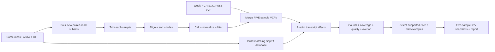

# Week 8 — commands in chronological order

This guide explains the actual analysis, from the reference files to a five-sample IGV session. Run shell commands in Linux or WSL, from `Week-8/`. The Makefile runs the same steps and stops when a command fails. Results must come from the real inputs; the tests use temporary synthetic fixtures only.



## 0. Create the software environment

```bash
conda env create -f environment.yml   # Install the declared tools into a separate environment.
conda activate bmmb852-week8          # Select that environment for all following commands.
cd /path/to/BMB852/Week-8             # Replace this with your actual Week-8 directory.
```

Create the environment while already in `Week-8/`, or pass the full path to `environment.yml`. Conda/Mamba must already be installed. The environment declares Python, BWA, SAMtools, BCFtools, cutadapt, Java, matplotlib, Make, and curl. Java runs SnpEff; an IGV installation with Java 21 and a working graphical display is needed for snapshots. Read [the tested versions](provenance/all-tool-versions.txt) and [SnpEff version](provenance/snpeff-version.txt).

For this workstation only, existing environments are selected with:

```bash
export PATH=/opt/bmb852/week5/bin:/opt/miniforge3/envs/bioinfo/bin:$PATH
```

`export` makes the setting available to child programs. `PATH` is searched left to right for executable commands. This workstation path is not required on another machine using the supplied Conda environment.

## 1. Define the samples and obtain the exact reference

```bash
reference=../Week-5/fasta/GCA_000002425.2_Phypa_V3_genomic.fna
annotation=../Week-2/data/GCA_000002425.2_Phypa_V3_genomic.gff
runs="ERR8982183 ERR8982184 ERR8982185 ERR8982186 ERR8982187"
pairs=20000000
threads=4
make setup-reference
```

| Line | Meaning |
|---|---|
| `reference=...` | Store the path to the exact Week 7 reference FASTA. |
| `annotation=...` | Store the path to the GFF for the same assembly. |
| `runs=...` | Set five distinct sequencing-run IDs; ERR8982185 is the original Week 7 sample. |
| `pairs=20000000` | Use the first 20 million paired records from each run. |
| `threads=4` | Use four BWA/cutadapt worker threads per sample. |
| `make setup-reference` | Reuse existing reference files; fetch missing files from NCBI and create missing indexes. |

The Makefile has the same defaults. If using other file locations, pass `REFERENCE=/path/ref.fna GFF=/path/genes.gff` to each Make command. `samtools faidx` creates the `.fai` random-access FASTA index; `bwa index` creates the alignment index. Neither index changes the nucleotide sequence. Assembly accession and chromosome names must agree between FASTA, GFF, BAMs, and VCFs.

Sample identities and original ENA FASTQ URLs/sizes are archived in [samples.tsv](samples.tsv) and [study-runs.tsv](provenance/study-runs.tsv). The FASTA and GFF are approximately 478 MB and 109 MB uncompressed. Read files, BAMs, indexes, and database files require additional disk space.

## 2. Download synchronized read pairs

The next commands show one new sample. The Makefile repeats the same processing for each new run.

```bash
run=ERR8982183
out="samples/$run"
mkdir -p "$out" provenance
python3 scripts/download_sample.py --run "$run" --pairs "$pairs" --output "$out/raw" > "$out/download.log" 2>&1
```

| Line / symbol | Meaning |
|---|---|
| `run=...` | Choose Control#1 for this example. |
| `out=...` | Keep that sample's files in its own directory. |
| `mkdir -p` | Create directories; existing directories are allowed. |
| `python3 scripts/download_sample.py` | Execute the included downloader, using the archived ENA metadata. |
| `--run`, `--pairs`, `--output` | Specify the run, number of paired records, and output directory. |
| `>` | Save standard output to a log file. |
| `2>&1` | Save error messages in the same log. |
| `"$variable"` | Expand a shell variable while keeping paths as one argument. |

The downloader reads ordered HTTPS byte ranges, decompresses them, and retains exactly the first N complete records from each mate. It checks FASTQ structure and equal sequence/quality lengths, hashes the read IDs, verifies synchronization of the two mates, and writes checksums plus `download.json`. This subset is deterministic, but is not random or the complete run. See [the full downloader](scripts/download_sample.py) and [the shared range-reader implementation](../Week-7/scripts/download_subset.py).

The processing script waits for a separately started prefetch of the same run. [check_download.py](scripts/check_download.py) verifies the sample, pair count, matching mate IDs, and compressed-file checksums before an existing download is reused. Incomplete `.part` files are not accepted as completed inputs.

## 3. Trim adapters and low-quality read ends

```bash
cutadapt -j "$threads" \
  -a AGATCGGAAGAGCACACGTCTGAACTCCAGTCA \
  -A AGATCGGAAGAGCGTCGTGTAGGGAAAGAGTGT \
  -q 20,20 -m 30 \
  --json "$out/cutadapt.json" \
  -o "$out/read1.trimmed.fastq.gz" \
  -p "$out/read2.trimmed.fastq.gz" \
  "$out/raw/${run}_1.fastq.gz" "$out/raw/${run}_2.fastq.gz" \
  > "$out/cutadapt.log" 2>&1
```

| Line / option | Meaning |
|---|---|
| `cutadapt -j` | Run cutadapt with the selected number of workers. |
| `-a` / `-A` | Supply the mate-1 and mate-2 Illumina adapter sequences. |
| `-q 20,20` | Trim low-quality bases from both ends using a quality threshold of 20. |
| `-m 30` | Require a minimum read length of 30 bases after trimming. |
| `--json` | Save machine-readable trimming statistics. |
| `-o` / `-p` | Write the trimmed first and second mates. |
| Two final input paths | Read the paired raw FASTQ files in mate order. |
| `\` at a line end | Continue a single shell command onto the next displayed line. |

Reads are processed as pairs. The JSON and log provide the retained-pair counts; inspect them rather than assuming all 20 million pairs survive trimming.

## 4. Align, sort, validate, and index each sample

```bash
bwa mem -t "$threads" -R "@RG\tID:$run\tSM:$run\tPL:ILLUMINA" \
  "$reference" "$out/read1.trimmed.fastq.gz" "$out/read2.trimmed.fastq.gz" \
  2> "$out/bwa.log" | \
  samtools sort -@ 2 -m 256M -o "$out/$run.sorted.bam" 2> "$out/sort.log"
samtools quickcheck -v "$out/$run.sorted.bam"
samtools index "$out/$run.sorted.bam"
samtools flagstat "$out/$run.sorted.bam" > "$out/flagstat.txt"
```

| Line / option | Meaning |
|---|---|
| `bwa mem` | Align paired reads to the reference. |
| `-t` | Set alignment worker threads. |
| `-R` | Add a read group; `ID` identifies the run, `SM` identifies the sample, and `PL` records the platform. Distinct `SM` values are essential for a real multisample VCF. |
| `\t` inside `-R` | BWA interprets these literal escapes as read-group tab separators. |
| `2>` | Send errors/progress to the specified log without mixing them with alignments. |
| `|` | Stream alignments directly to the next program without creating a large SAM file. |
| `samtools sort -@ 2 -m 256M` | Sort by reference coordinate, using two sorting workers and approximately 256 MB per sorting thread. |
| `-o` | Write the coordinate-sorted BAM. |
| `quickcheck -v` | Check the BAM header/end marker and report failures; this is not an exhaustive biological alignment validation. |
| `samtools index` | Write the `.bam.bai` index needed for fast region access and IGV. |
| `samtools flagstat` | Count alignment categories, including mapped and properly paired records. |

The Week 7 ERR8982185 BAM/VCF can be reused at the identical 20-million-pair setting when the PASS VCF, BAM, and BAM index are all present. On a fresh checkout without that BAM, ERR8982185 is downloaded and processed in Week 8 like the other samples. Other samples are independently aligned. Old Week 7 data are not relabeled to create additional samples.

## 5. Call, normalize, and filter variants separately

```bash
bcftools mpileup -Ou -f "$reference" -q 20 -Q 20 -d 1000 \
  -a FORMAT/DP,FORMAT/AD "$out/$run.sorted.bam" 2> "$out/mpileup.log" | \
  bcftools call -mv --ploidy 1 -Ou 2> "$out/call.log" | \
  bcftools norm -f "$reference" -c e -m -any -Ou 2> "$out/norm.log" | \
  bcftools filter -s LowQualOrDepth -e 'QUAL<20 || FMT/DP<3' \
  -Oz -o "$out/$run.filtered.vcf.gz"
bcftools view -f PASS -Oz -o "$out/$run.pass.vcf.gz" "$out/$run.filtered.vcf.gz"
bcftools index -f "$out/$run.pass.vcf.gz"
bcftools query -l "$out/$run.pass.vcf.gz"
bcftools stats "$out/$run.pass.vcf.gz" > "$out/pass.stats.txt"
```

| Line / option | Meaning |
|---|---|
| `mpileup` | Calculate genotype likelihoods from aligned bases. |
| `-Ou` | Stream uncompressed BCF between commands. |
| `-f` | Use this FASTA to interpret reference alleles. |
| `-q 20` / `-Q 20` | Require minimum mapping quality 20 and base quality 20. |
| `-d 1000` | Cap pileup depth at 1,000 per input file; this is not a maximum-depth filter on the final callset. |
| `-a FORMAT/DP,FORMAT/AD` | Retain usable sample depth and reference/alternate allele depths. |
| `call -m -v` | Use the multiallelic caller and emit variant sites. |
| `--ploidy 1` | Use the same haploid model as Week 7. This remains an inferred biological assumption. |
| `norm -c e` | Check REF alleles against the FASTA and stop on a mismatch. |
| `norm -m -any` | Split multiallelic records and normalize allele representations. |
| `filter -s LowQualOrDepth` | Label failing calls while keeping them in the filtered VCF. |
| `-e 'QUAL<20 || FMT/DP<3'` | Fail calls with quality below 20 OR usable sample depth below 3. |
| `-Oz` | Write BGZF-compressed VCF, which can be indexed. |
| `view -f PASS` | Extract only records that passed the filters. |
| `index -f` | Create or replace the CSI index for that newly generated VCF. |
| `query -l` | Print the sample identity stored in the VCF header. The processing script checks that it equals the expected run. |
| `stats` | Save a standard summary of variant types and other call statistics. |

The executed implementation is [process_sample.sh](scripts/process_sample.sh). `set -euo pipefail` at its start stops on failed commands, unset variables, and failed stages within pipelines.

## 6. Merge the five genuine sample VCFs

```bash
bcftools merge -m none -Oz -o results/five_samples.vcf.gz \
  samples/ERR8982183/ERR8982183.pass.vcf.gz \
  samples/ERR8982184/ERR8982184.pass.vcf.gz \
  samples/ERR8982185/ERR8982185.pass.vcf.gz \
  samples/ERR8982186/ERR8982186.pass.vcf.gz \
  samples/ERR8982187/ERR8982187.pass.vcf.gz
bcftools index -f results/five_samples.vcf.gz
bcftools query -l results/five_samples.vcf.gz > results/merged_samples.txt
test "$(wc -l < results/merged_samples.txt)" -eq 5
bcftools norm -f "$reference" -c e -Ov results/five_samples.vcf.gz > /dev/null
bcftools stats -s - results/five_samples.vcf.gz > results/five_samples.stats.txt
```

| Line / option | Meaning |
|---|---|
| `merge` plus five input paths | Combine columns from five distinct sample callsets. This is not `concat`, which combines records from the same samples across regions. |
| `-m none` | Keep different allele records separate instead of creating new multiallelic combinations. |
| `index` | Index the merged file for region queries. |
| `query -l ... > ...` | Save the five sample IDs in their actual merged column order. |
| `test ... -eq 5` | Stop unless the header contains five sample columns. |
| `norm ... > /dev/null` | Validate reference consistency while discarding the validation command's duplicate VCF output. |
| `stats -s -` | Include statistics for all samples; the second `-` means all sample names. |

**Missing calls remain missing.** We do not use `--missing-to-ref`. Because each input is a variant-only PASS VCF, a missing record cannot distinguish true reference from insufficient coverage or filtering. The later analysis additionally checks that every merged allele is in the exact union of the five input VCFs and that genotypes agree with their original samples. REF and ALT are compared case-insensitively: lowercase soft-masked alleles are the same biological bases as their uppercase merged representations.

## 7. Build the matching database and predict effects

```bash
make setup-annotation
make annotate
```

The first command downloads the official SnpEff distribution, checks the archived software hashes when available, and records its version. The second runs the following underlying stages:

```bash
mkdir -p annotation/data/Phypa_V3
ln -sfn "$(realpath "$reference")" annotation/data/Phypa_V3/sequences.fa
ln -sfn "$(realpath "$annotation")" annotation/data/Phypa_V3/genes.gff
printf '%s\n' 'data.dir = ./data' 'Phypa_V3.genome : Physcomitrium patens Phypa V3' > annotation/snpEff.config
(
  cd annotation
  java -Xmx4g -jar ../tools/snpEff/snpEff.jar build -gff3 \
    -noCheckCds -noCheckProtein -v -c snpEff.config Phypa_V3
)
java -Xmx4g -jar tools/snpEff/snpEff.jar \
  -c annotation/snpEff.config -dataDir "$(realpath annotation/data)" \
  -noDownload -noStats -v Phypa_V3 results/five_samples.vcf.gz | \
  python3 scripts/fix_ann_delimiters.py --gff "$annotation" | \
  bcftools view -Oz -o results/five_samples.annotated.vcf.gz
bcftools index -f results/five_samples.annotated.vcf.gz
bcftools index -t -f results/five_samples.annotated.vcf.gz
```

| Line / option | Meaning |
|---|---|
| `mkdir` | Create the custom genome's database directory. |
| `ln -sfn` | Point SnpEff to the existing FASTA and GFF; replace only the local symlink if needed. |
| `realpath` / `$(...)` | Resolve an absolute path and insert that command's output into this command. |
| `printf` | Write the two configuration entries, one per line. |
| Parenthesized block and `cd` | Build from inside the annotation directory, without changing the parent shell's directory. |
| `java -Xmx4g -jar` | Run the jar with a maximum Java heap of 4 GB. |
| `build -gff3` | Create a predictor from the matching reference sequence and transcript features. |
| `-noCheckCds -noCheckProtein` | Skip separate CDS/protein FASTA validation; this limits independent validation of the transcript models. |
| `-v` / `-c` | Enable detailed logs and select the local configuration. |
| `Phypa_V3` | Select this custom database name, not an unrelated prebuilt genome. |
| `-dataDir` | Explicitly locate the local database. |
| `-noDownload` | Require the local database rather than fetching a substitute. |
| `-noStats` | Disable SnpEff's own HTML summary; the included scripts generate transparent summaries instead. |
| `fix_ann_delimiters.py` | Percent-encode literal pipes inside NCBI transcript IDs as `%7C`, preserving exactly 16 ANN fields so HGVS and warnings stay in their correct columns. `--gff` also restores source pseudogene biotypes from NCBI `pseudogene` features and `pseudo=true` attributes; variant alleles and sample genotypes are preserved. |
| `view -Oz` | Compress SnpEff's annotated VCF without changing the sample identities. |
| `index -t -f` | Add a Tabix `.tbi` index for IGV; the CSI index remains available for BCFtools. |

SnpEff appends transcript consequences in `INFO/ANN`. Review warnings, transcript IDs, HGVS changes, and read evidence before interpreting HIGH or MODERATE predictions. More than one annotation per variant is normal. The recorded software hashes prevent silently accepting a changed `latest` download; if upstream changes it, obtain the recorded version and supply `SNPEFF_URL` rather than bypassing checksum validation.

## 8. Compare the samples and create result figures

```bash
python3 scripts/summarize_effects.py results/five_samples.annotated.vcf.gz --output results
python3 scripts/analyze_multisample.py
python3 scripts/collect_coverage.py --reference "$reference"
python3 scripts/plot_comparisons.py
```

| Line | Meaning and saved evidence |
|---|---|
| `summarize_effects.py` | Require five distinct sample columns; export every transcript annotation, warnings, genotype counts, and one most severe impact per record. |
| `analyze_multisample.py` | Compare the five PASS sets, verify exact allele union/genotypes, count SNPs/indels and overlap patterns, retain QUAL/DP distributions, and choose supported IGV examples. |
| `collect_coverage.py` | Run `samtools coverage -q 20 -Q 0` on each real BAM, calculate reference coverage with the full FASTA length denominator, and retain mapping statistics. |
| `plot_comparisons.py` | Draw measured SNP/indel counts, depth/quality boxplots, predicted impact counts, and observed callset overlap. Figures are saved in `png/`. |

Boxplots hide outliers to show their central distributions; this does not remove outliers from the VCF. Overlap means shared retained calls, not shared callable reference sites. The chosen IGV examples require QUAL >= 50, mapping quality >= 50, usable depth 8–60, at least eight alternate observations, and alternate fraction >= 0.8 in at least one sample. Unfiltered depth must be <= 100 in every sample and >= 12 in at least one; the 81-base reference window must contain no N bases. Selection prioritizes warning-free predictions and aims for one indel and two distinct SNPs, as in Week 7. A predicted HIGH-impact indel, MODERATE-impact SNP, and synonymous SNP are preferred when available. Functional examples use protein-coding transcript annotations; pseudogene consequences are counted separately in the summary. Loci separated by more than 500 bp are favored. This is not a random sample of all variants.

The plotting code needs matplotlib. On the current workstation, its isolated interpreter is `tools/plotenv/bin/python`; the Makefile selects it automatically. The supplied Conda environment provides matplotlib directly on a fresh setup.

## 9. Visualize the merged genotypes and all five BAMs in IGV

```bash
python3 scripts/prepare_igv.py --reference "$reference" --gff "$annotation"
bash scripts/run_igv.sh
```

The first command writes an IGV batch file, compact nearby transcript tracks, and independently generated local pileups for all five samples. The second starts the installed IGV application and runs that batch. Set `IGV_DIR=/path/to/IGV` when the installation is elsewhere. A Linux graphical display or WSLg is required.

Representative batch commands, in execution order:

```text
new
genome /absolute/path/to/reference.fna
snapshotDirectory /absolute/path/to/Week-8/png
load /absolute/path/to/Week-8/results/five_samples.annotated.vcf.gz
load /absolute/path/to/Week-8/results/igv_genes.bed
maxPanelHeight 2400
setSequenceShowTranslation false
expand
goto CHROM:START-END
snapshot 05_five_sample_genotypes.png
load /absolute/path/to/sample.sorted.bam
setTrackHeight 240 sample.sorted.bam
colorBy READ_STRAND
scrollToTop
goto CHROM:START-END
sort BASE CHROM:POSITION
snapshot 06_candidate_1.png
saveSession /absolute/path/to/Week-8/igv/five_samples.session.xml
exit
```

| Command | Meaning |
|---|---|
| `new`, `genome` | Reset the session and select the matching FASTA. |
| `snapshotDirectory`, `load` | Set image output and load the VCF/nearby gene models. |
| `maxPanelHeight`, `expand` | Allow enough vertical space and display sample rows. |
| `setSequenceShowTranslation` | Hide translation rows for a simpler reference display. |
| `goto`, `snapshot` | Visit a real selected interval and save its image. |
| BAM `load`, `setTrackHeight` | Add each of five indexed alignments and size its track. |
| `colorBy`, `scrollToTop`, `sort` | Display strand colors, show the top tracks, and order reads by the selected base. |
| `saveSession`, `exit` | Save a reopenable session and close this batch instance. |

The generated batch repeats BAM loading for all five samples and snapshot commands for each selected locus, followed by a regional view. The commands above are a schema: use the generated [batch file](igv/five_samples.batch.txt) for actual paths and coordinates. IGV documentation: [batch commands](https://igv.org/doc/desktop/UserGuide/tools/batch/) and [command-line launch](https://igv.org/doc/desktop/UserGuide/advanced/command_line/).

For Windows IGV, generate a Windows-path batch instead:

```bash
python3 scripts/prepare_igv.py --reference "$reference" --gff "$annotation" --igv-root C:/path/to/BMB852
```

Run `igv/five_samples.windows.batch.txt` through **Tools → Run Batch Script** in Windows IGV. Replace the root with your actual checkout. Local session paths are machine-specific, so regenerate them after moving the repository.

## 10. Reproduce everything and verify completion

```bash
make test                    # Test five-sample union and missing-genotype behavior on temporary fixtures.
make all                     # Process samples, merge, annotate, and summarize effects.
make report                  # Add comparisons, coverage, figures, real IGV images, and the final README.
cat results/merged_samples.txt
cat provenance/pipeline-status.json
sha256sum -c provenance/merged.sha256
```

`make` uses file dependencies to avoid repeating completed stages; changed input parameters trigger new processing. Run the sample processing serially unless your machine has enough RAM for several BWA jobs. `make report` can be rerun after changing plotting or report code. The state file is maintained by the queued completion runner on this workstation; if running Make directly elsewhere, use Make's exit status, the five sample IDs, checksums, and generated outputs as completion evidence.

The final delivery is the **one annotated merged VCF**, `results/five_samples.annotated.vcf.gz`, with its adjacent index. The pre-annotation merged VCF is retained as an intermediate. The original single-sample inputs are retained for provenance. A successful file generation does not establish that predicted variants cause a phenotype.


### Worker counts used in this run

Control#1 and CRIS1#2 used four alignment workers; Control#2 and CRIS2#1 used three so two samples could run alongside each other on this workstation. To match those settings on a fresh checkout, build the sample targets in this order before running the report:

```bash
make samples/ERR8982183/ERR8982183.pass.vcf.gz THREADS=4
make samples/ERR8982184/ERR8982184.pass.vcf.gz THREADS=3
make samples/ERR8982185/ERR8982185.pass.vcf.gz THREADS=4
make samples/ERR8982186/ERR8982186.pass.vcf.gz THREADS=4
make samples/ERR8982187/ERR8982187.pass.vcf.gz THREADS=3
make report
```

Each line processes one sample or reuses the verified Week 7 sample; the final line assembles the five-sample results and visualizations. Concurrent execution is optional. BWA's default batch size depends on worker count, so record these settings when comparing exact call counts. The cutadapt JSON files and processing logs record the worker settings used.

## Full executable source

No analysis implementation is hidden: [Makefile](Makefile), [download](scripts/download_sample.py), [download checks](scripts/check_download.py), [sample processing](scripts/process_sample.sh), [ANN formatting](scripts/fix_ann_delimiters.py), [annotation summary](scripts/summarize_effects.py), [sample comparison](scripts/analyze_multisample.py), [coverage](scripts/collect_coverage.py), [plots](scripts/plot_comparisons.py), [IGV preparation](scripts/prepare_igv.py), [IGV launcher](scripts/run_igv.sh), and [report generation](scripts/write_report.py). This guide expands the analytical commands and their options; these source files contain the complete helper implementations.
# Whole merged VCF overview

After the five-sample annotated VCF is generated, run:

```bash
python scripts/visualize_merged.py
```

`python` starts the interpreter in the activated environment; `scripts/visualize_merged.py` reads every compressed VCF record, extracts each sample's genotype and the most severe transcript impact, checks the sample order and call-pattern counts against the validated merge summary, then writes the whole-contig figure, the complete call-pattern chart, the pairwise Jaccard matrix, and a measured interpretation. It does not rerun alignments or alter the VCF. `make figures` and `make report` also run this step when needed. On this workstation the plotting interpreter is `tools/plotenv/bin/python`.

See [whole-VCF analysis](results/WHOLE_VCF_ANALYSIS.md) and [complete source](scripts/visualize_merged.py). A retained-call Jaccard score is shared allele records divided by allele records retained in either sample; missing calls are unknown.

