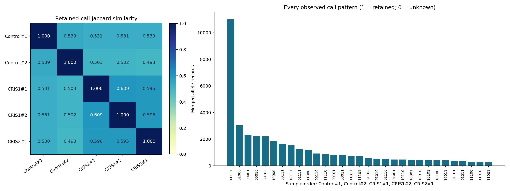
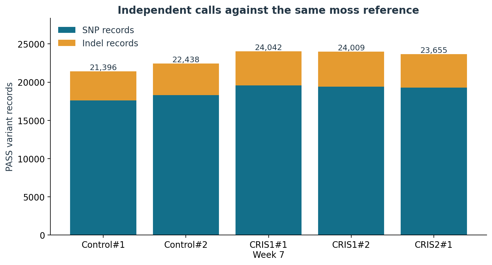
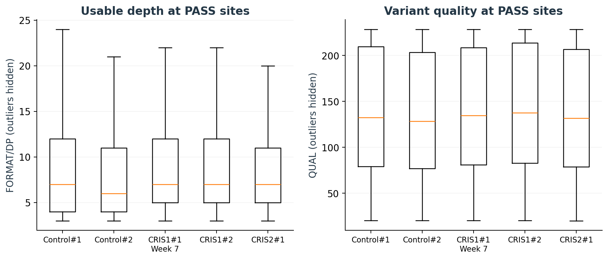
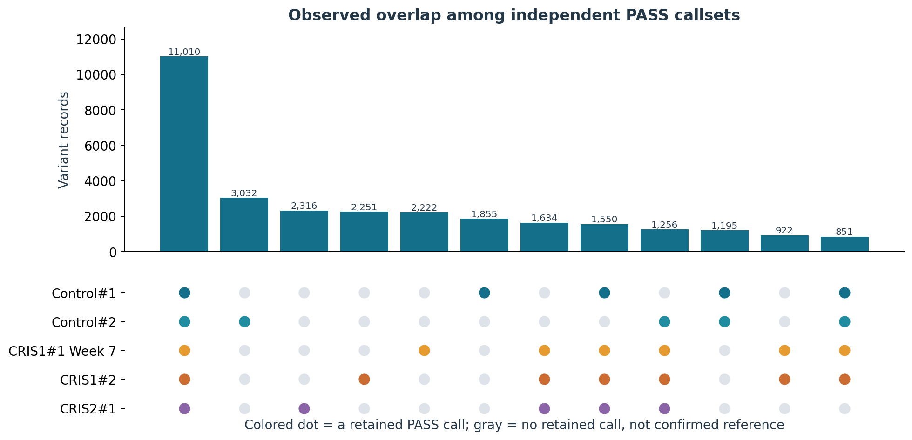
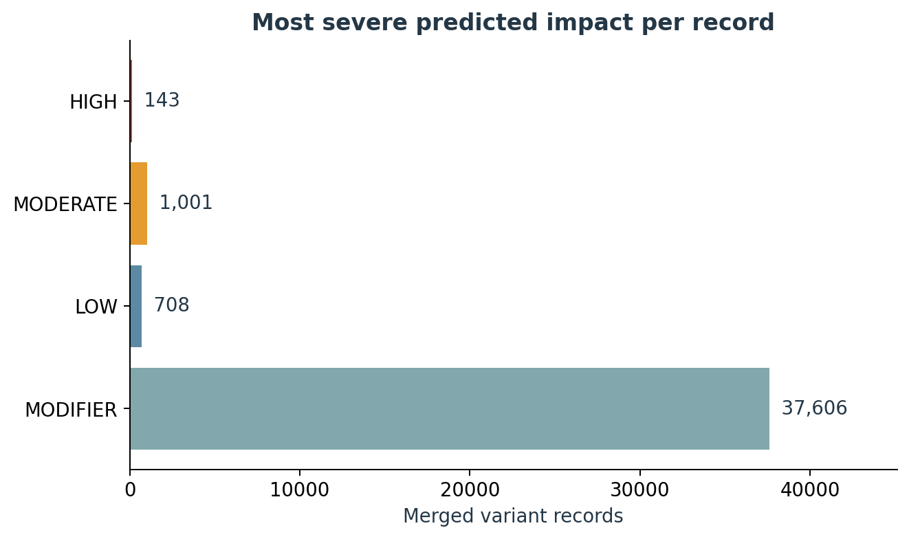
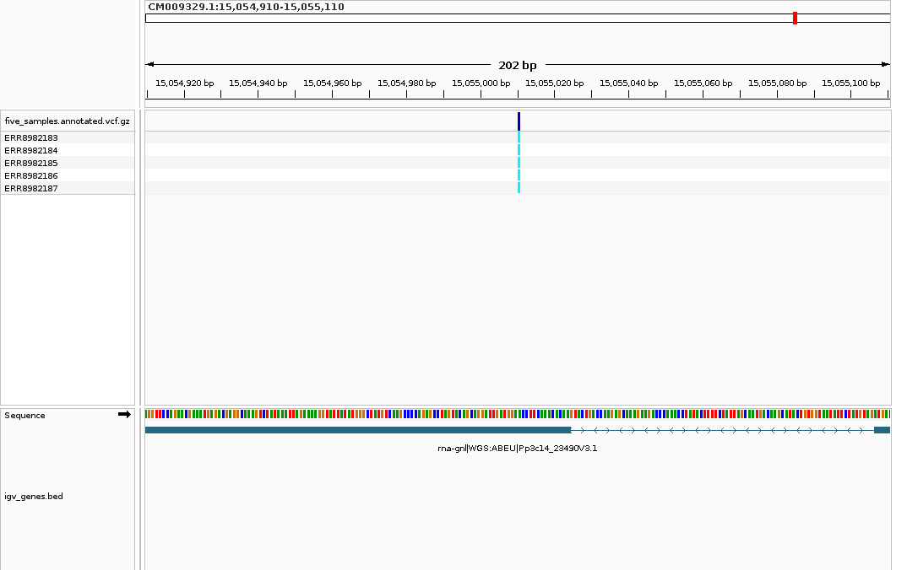
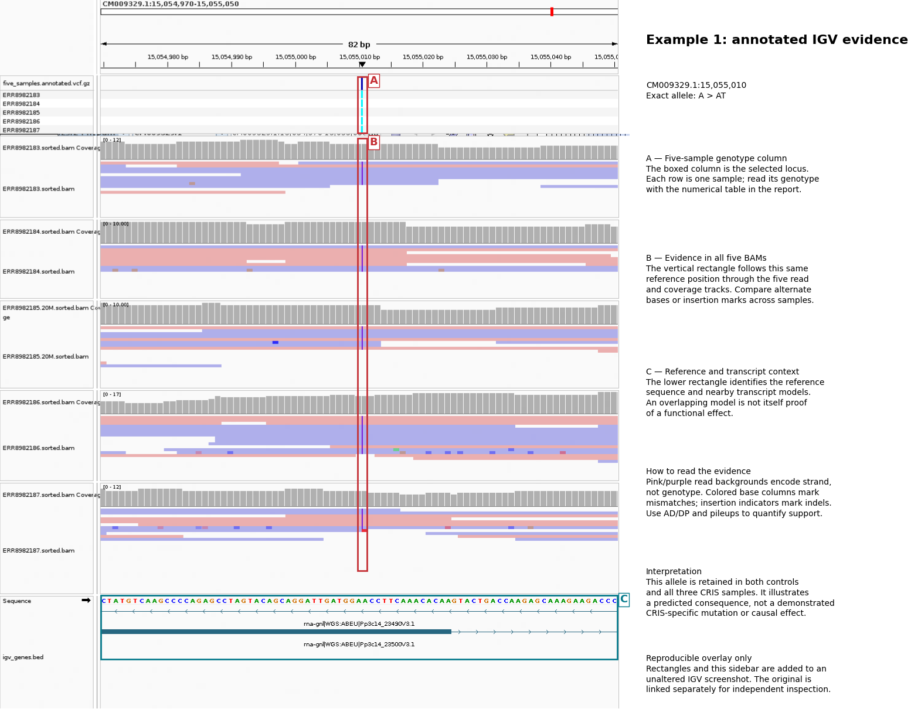
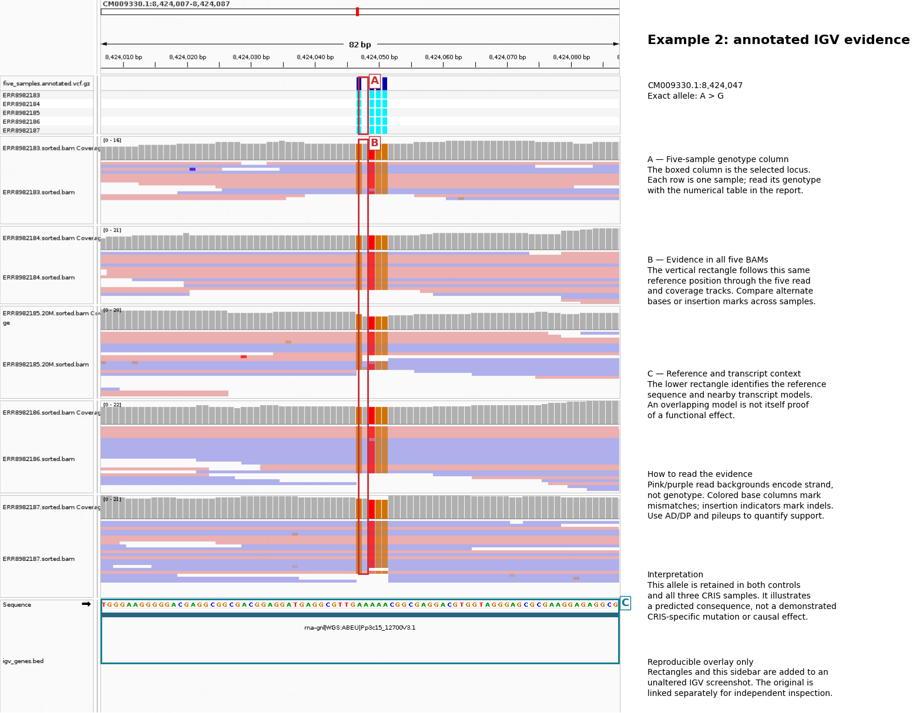
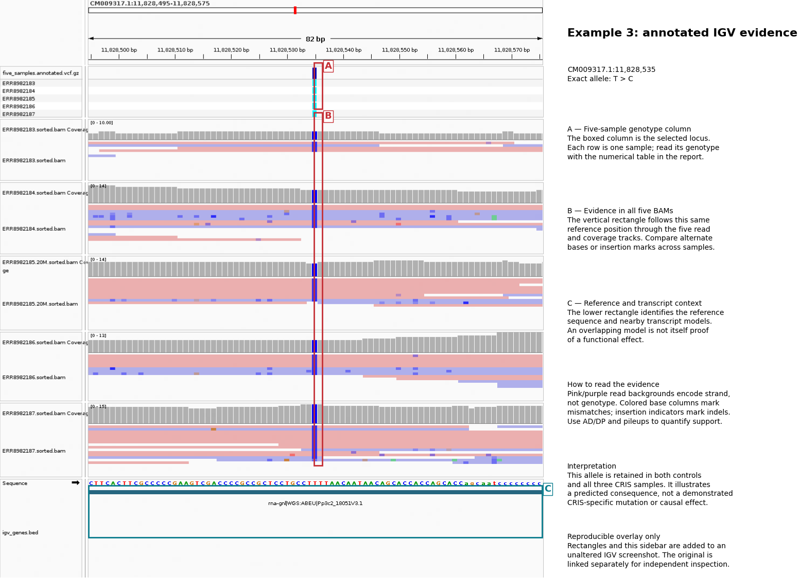
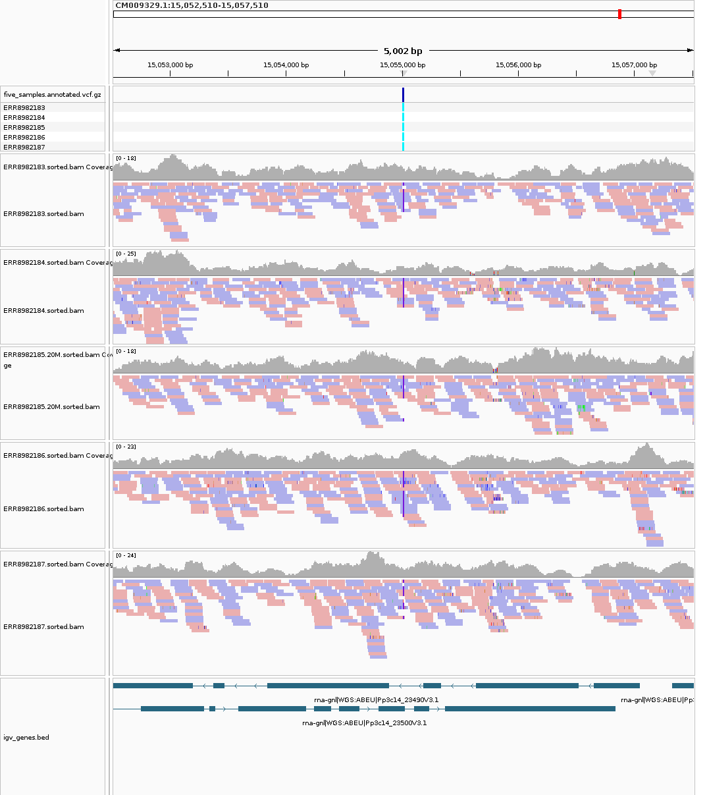

# Week 8  -  five-sample variant analysis

**Start here to reproduce:** [setup, quick figure reproduction, full read processing, IGV, and verification](REPRODUCE.md).

**Detailed interpretation:** [what every result means, with boxed IGV screenshots](RESULTS_EXPLAINED.md).

## Sequencing Data and Reference Genome

I extended the Week 7 *Physcomitrium patens* analysis from one sample to five: the original CRIS1#1 sample plus four additional samples from study **PRJEB51295**. Each new sample was processed independently against the same reference, **GCA_000002425.2_Phypa_V3**, before merging and predicting transcript effects.

| Sample | Run | Experiment | Biosample |
|---|---|---|---|
| Control#1 | [ERR8982183](https://www.ebi.ac.uk/ena/browser/view/ERR8982183) | ERX8525938 | SAMEA13207854 |
| Control#2 | [ERR8982184](https://www.ebi.ac.uk/ena/browser/view/ERR8982184) | ERX8525939 | SAMEA13207855 |
| CRIS1#1 · original Week 7 | [ERR8982185](https://www.ebi.ac.uk/ena/browser/view/ERR8982185) | ERX8525940 | SAMEA13207856 |
| CRIS1#2 | [ERR8982186](https://www.ebi.ac.uk/ena/browser/view/ERR8982186) | ERX8525941 | SAMEA13207857 |
| CRIS2#1 | [ERR8982187](https://www.ebi.ac.uk/ena/browser/view/ERR8982187) | ERX8525942 | SAMEA13207858 |

The first **20 million paired records per run** were used, matching the expanded Week 7 analysis. This is deterministic prefix sampling, not random sampling or the full runs. At this setting, the independently processed Week 7 CRIS1#1 VCF/BAM were reused; the other four samples were downloaded and processed separately. The same matching reference FASTA and GFF3 were used for annotation.

> **Final merged file:** [five_samples.annotated.vcf.gz](results/five_samples.annotated.vcf.gz) · [Tabix index](results/five_samples.annotated.vcf.gz.tbi) · [five sample IDs](results/merged_samples.txt)

**Reproduce the analysis:** [chronological commands and every analytical option explained](CODE_GUIDE.md) · [Makefile](Makefile) · [software environment](environment.yml) · [IGV batch](igv/five_samples.batch.txt) · [IGV session](igv/five_samples.session.xml)

## Whole merged VCF overview

Every merged allele record and all 31 observed call patterns are visualized in the [whole-VCF analysis](results/WHOLE_VCF_ANALYSIS.md). It includes all 214 contigs with calls, pairwise retained-call similarity, and interpretation of shared versus missing calls.



The three IGV examples have alternate calls in both controls and all three CRIS samples; they do not distinguish treatment groups. Shared calls can reflect differences from the chosen reference. Sample-specific missing entries require common-site genotyping before biological absence can be inferred.

## Results

### 1. Five separate callsets → one multisample VCF

| Sample | PASS records | SNPs | Indels | Median DP | Median QUAL |
|---|---:|---:|---:|---:|---:|
| Control#1 | 21,396 | 17,613 | 3,783 | 7.0 | 132.42 |
| Control#2 | 22,438 | 18,303 | 4,135 | 6.0 | 128.32 |
| CRIS1#1 | 24,042 | 19,576 | 4,466 | 7.0 | 134.42 |
| CRIS1#2 | 24,009 | 19,410 | 4,599 | 7.0 | 137.42 |
| CRIS2#1 | 23,655 | 19,291 | 4,364 | 7.0 | 131.42 |

The merged VCF contains **39,458 distinct allele records**: **32,276 SNP records** and **7,182 indel records**. The workflow verified the exact union of all five input callsets, the sample-column order, and every carried genotype. There are **11,010 allele records retained in all five samples**.





The allele-union check compares REF/ALT case-insensitively: the soft-masked reference produces some lowercase input alleles, while BCFtools merge writes uppercase. Letter case does not define a different biological variant. All sample genotypes were checked against their corresponding input calls.

The boxplots show PASS-site distributions; outliers are hidden only in the display. These are variant-site depths, not genome-wide average coverage.

### 2. Alignment and genome coverage

| Sample | Primary mapped | Reference covered | Mean reference depth |
|---|---:|---:|---:|
| Control#1 | 81.77% | 96.19% | 8.031× |
| Control#2 | 83.41% | 96.28% | 8.232× |
| CRIS1#1 | 74.31% | 96.48% | 8.418× |
| CRIS1#2 | 75.05% | 96.24% | 8.566× |
| CRIS2#1 | 71.56% | 96.38% | 8.072× |

Coverage was measured with `samtools coverage -q 20 -Q 0`, using the full FASTA length as the denominator, including uncovered sequence. Mapping percentages are from primary alignment records in flagstat. The coverage command differs from the Week 7 `samtools depth` implementation; compare the definitions as well as the values. See [coverage measurements](results/coverage_comparison.tsv).

### 3. Observed overlap and missing calls



Each colored dot marks a retained PASS call in that sample. Gray means no retained call at that allele; it does **not** establish reference genotype. The plot shows the twelve largest observed patterns. Independent variant-only callsets cannot support treatment-specific absence claims without a shared callable-site analysis or genotyping at common sites.

### 4. Predicted transcript effects

SnpEff uses a custom database built from the matching moss FASTA and GFF. The final merged VCF retains all five sample columns and adds `INFO/ANN` transcript annotations.

NCBI transcript identifiers contain literal pipe characters. These delimiters are percent-encoded as `%7C` inside `ANN` Feature_ID values, and every annotation is validated to contain exactly 16 fields, preserving the correct HGVS and warning columns. The source transcript identifiers are retained.

NCBI GFF pseudogene features and `pseudo=true` attributes are also used to label the corresponding ANN transcript biotype as `pseudogene`. The selected functional examples below use protein-coding transcript models.

| Most severe predicted impact per record | Records |
|---|---:|
| HIGH | 143 |
| MODERATE | 1,001 |
| LOW | 708 |
| MODIFIER | 37,606 |

Annotations were present for **39,458 / 39,458 records**. Counts above assign one most severe impact to each record; [all transcript annotations](results/variant_effects.tsv) can contain several rows per variant.

Among records with HIGH annotations, **142** include a protein-coding transcript and **1** include a pseudogene transcript. Categories can overlap when a record has multiple annotations. A pseudogene consequence is not evidence of a functional protein change.



The database was built without separate CDS/protein FASTA validation (`-noCheckCds -noCheckProtein`). Predicted impacts depend on transcript models and are not experimentally established effects. Annotation warnings are retained in [effect_summary.json](results/effect_summary.json).

### 5. Five-sample IGV visualization

The first image shows the merged genotype track with five sample rows and nearby transcript models. The following close-ups load all five indexed BAMs, the same reference, and the annotated multisample VCF. Read backgrounds are colored by strand; mismatch bases and indel markers should be evaluated alongside the reference and coverage.



#### Example 1: CM009329.1:15,055,010 · A>AT

**Predicted HIGH: `frameshift_variant`** · gene `PHYPA_018940` · transcript `rna-gnl|WGS:ABEU|Pp3c14_23500V3.1`.

HGVS coding change: `c.2411_2412insT`; protein change: `p.Glu804fs`. Annotation warning: `none on this selected annotation`.

NCBI transcript product: **hypothetical protein**. A hypothetical-protein label does not assign a biochemical function.

| Sample | Original GT | Usable DP | AD (REF,ALT) | Original QUAL |
|---|---|---:|---|---:|
| Control#1 | `1` | 8 | `0,8` | 176.42 |
| Control#2 | `1` | 9 | `0,9` | 208.42 |
| CRIS1#1 | `1` | 8 | `0,8` | 209.42 |
| CRIS1#2 | `1` | 12 | `0,12` | 225.42 |
| CRIS2#1 | `1` | 7 | `0,7` | 185.42 |

The annotated indel changes the coding reading frame in this transcript; the predicted downstream protein sequence can therefore change.



**A  -  Genotype column:** The boxed column marks the selected allele across five sample rows. Read the sample genotypes alongside the numerical table above.

**B  -  Read evidence:** The vertical rectangle follows the same reference position through all five BAM and coverage tracks. Compare mismatch bases or insertion markers at this position. Pink/purple read backgrounds indicate strand, while AD and DP quantify usable allele support.

**C  -  Reference and transcript context:** The lower rectangle identifies the reference sequence and nearby transcript models. Transcript overlap provides annotation context; it does not independently establish a functional effect.

**Interpretation:** Both controls and all three CRIS samples retain this alternate allele. It illustrates a predicted transcript consequence, without establishing a CRIS-specific mutation or causal effect.

[Original unannotated screenshot](png/06_candidate_1.png) · [Detailed interpretation](RESULTS_EXPLAINED.md). Rectangles are added to the original IGV output; the underlying data are unchanged.

This locus met the documented moderate-depth and alternate-support criteria in 4 sample(s). These measurements support prioritizing the locus for review; they do not by themselves prove causation. Check both read directions, read placement, local alignment context, and the separately saved [per-sample pileups](results/pileups/) before interpreting it.

#### Example 2: CM009330.1:8,424,047 · A>G

**Predicted MODERATE: `missense_variant`** · gene `PHYPA_019678` · transcript `rna-gnl|WGS:ABEU|Pp3c15_12700V3.1`.

HGVS coding change: `c.2263A>G`; protein change: `p.Lys755Glu`. Annotation warning: `none on this selected annotation`.

NCBI transcript product: **hypothetical protein**. A hypothetical-protein label does not assign a biochemical function.

| Sample | Original GT | Usable DP | AD (REF,ALT) | Original QUAL |
|---|---|---:|---|---:|
| Control#1 | `1` | 11 | `0,11` | 225.42 |
| Control#2 | `1` | 11 | `0,11` | 225.42 |
| CRIS1#1 | `1` | 13 | `0,13` | 225.42 |
| CRIS1#2 | `1` | 16 | `0,16` | 225.42 |
| CRIS2#1 | `1` | 18 | `0,18` | 225.42 |

The annotation predicts an amino-acid substitution. This classification alone does not establish whether protein function changes.



**A  -  Genotype column:** The boxed column marks the selected allele across five sample rows. Read the sample genotypes alongside the numerical table above.

**B  -  Read evidence:** The vertical rectangle follows the same reference position through all five BAM and coverage tracks. Compare mismatch bases or insertion markers at this position. Pink/purple read backgrounds indicate strand, while AD and DP quantify usable allele support.

**C  -  Reference and transcript context:** The lower rectangle identifies the reference sequence and nearby transcript models. Transcript overlap provides annotation context; it does not independently establish a functional effect.

**Interpretation:** Both controls and all three CRIS samples retain this alternate allele. It illustrates a predicted transcript consequence, without establishing a CRIS-specific mutation or causal effect.

[Original unannotated screenshot](png/06_candidate_2.png) · [Detailed interpretation](RESULTS_EXPLAINED.md). Rectangles are added to the original IGV output; the underlying data are unchanged.

This locus met the documented moderate-depth and alternate-support criteria in 5 sample(s). These measurements support prioritizing the locus for review; they do not by themselves prove causation. Check both read directions, read placement, local alignment context, and the separately saved [per-sample pileups](results/pileups/) before interpreting it.

#### Example 3: CM009317.1:11,828,535 · T>C

**Predicted LOW: `synonymous_variant`** · gene `PHYPA_002866` · transcript `rna-gnl|WGS:ABEU|Pp3c2_18051V3.1`.

HGVS coding change: `c.510T>C`; protein change: `p.Leu170Leu`. Annotation warning: `none on this selected annotation`.

NCBI transcript product: **hypothetical protein**. A hypothetical-protein label does not assign a biochemical function.

| Sample | Original GT | Usable DP | AD (REF,ALT) | Original QUAL |
|---|---|---:|---|---:|
| Control#1 | `1` | 4 | `0,4` | 110.42 |
| Control#2 | `1` | 9 | `0,9` | 183.42 |
| CRIS1#1 | `1` | 8 | `0,8` | 193.42 |
| CRIS1#2 | `1` | 8 | `0,8` | 199.42 |
| CRIS2#1 | `1` | 12 | `0,12` | 225.42 |

The annotation predicts a coding change without an amino-acid substitution in this transcript.



**A  -  Genotype column:** The boxed column marks the selected allele across five sample rows. Read the sample genotypes alongside the numerical table above.

**B  -  Read evidence:** The vertical rectangle follows the same reference position through all five BAM and coverage tracks. Compare mismatch bases or insertion markers at this position. Pink/purple read backgrounds indicate strand, while AD and DP quantify usable allele support.

**C  -  Reference and transcript context:** The lower rectangle identifies the reference sequence and nearby transcript models. Transcript overlap provides annotation context; it does not independently establish a functional effect.

**Interpretation:** Both controls and all three CRIS samples retain this alternate allele. It illustrates a predicted transcript consequence, without establishing a CRIS-specific mutation or causal effect.

[Original unannotated screenshot](png/06_candidate_3.png) · [Detailed interpretation](RESULTS_EXPLAINED.md). Rectangles are added to the original IGV output; the underlying data are unchanged.

This locus met the documented moderate-depth and alternate-support criteria in 4 sample(s). These measurements support prioritizing the locus for review; they do not by themselves prove causation. Check both read directions, read placement, local alignment context, and the separately saved [per-sample pileups](results/pileups/) before interpreting it.

#### Regional view



The regional view spans 5 kb around the first selected example and provides context for nearby coverage changes and calls. Its coverage tracks may autoscale independently, so compare numeric depths rather than apparent bar heights alone. All snapshots are actual IGV output; no illustrative read pileups were substituted.

Genomic REF/ALT alleles use the forward reference strand. Coding HGVS notation follows the transcript strand, so negative-strand genes can show complementary base letters.

## Reproduce in chronological order

The complete commands, line-by-line option explanations, expected outputs, and full source links are in [CODE_GUIDE.md](CODE_GUIDE.md). From this folder, the main steps are:

```bash
conda env create -f environment.yml
conda activate bmmb852-week8
make setup-reference
make setup-annotation
make test
make all
make report
```

`make all` independently processes the selected samples, merges, annotates, and summarizes. `make report` adds quantitative comparisons, reference coverage, figures, actual IGV snapshots, and this measured report. A working graphical display and IGV installation are required for its snapshot stage. On this workstation set `IGV_DIR=/opt/IGV_Linux_2.19.8`; elsewhere point it to your local IGV installation.

## Discussion and limits

This analysis compares retained variants and predicts their transcript consequences using the same reference as Week 7. Differences in call counts can arise from coverage, library properties, alignment quality, or filtering as well as biological variation. Prefix sampling is not random, and a haploid calling model was inferred rather than measured separately for each sample.

The selected control/CRIS sample groups are unbalanced. Neither their study labels nor the presence of a predicted HIGH-impact call proves an effect of CRISPR editing. Missing genotypes remain unknown. Candidate interpretation needs read-level review and, for causal claims, additional experimental evidence.

IGV images were generated programmatically and checked for valid, nonempty PNG files. Their existence alone does not establish visual review or biological validation; inspect the figures and reopen the saved session to review the evidence.

## Provenance and references

- [Sample metadata](samples.tsv), [ENA metadata archive](provenance/study-runs.tsv), and [verified fifth sample](provenance/fifth-sample-verified.tsv).
- [Archived read-subset manifests](provenance/read-subsets.json), including source URLs, mate synchronization hashes, selected counts, and downloaded-file hashes.
- [Merge checksums](provenance/merged.sha256), [tool versions](provenance/all-tool-versions.txt), [SnpEff software hashes](provenance/snpeff-software.sha256), and [pipeline status](provenance/pipeline-status.json).
- [Week 8 assignment](https://www.biostarhandbook.com/courses/2026/appbio/variants/variant-effect-prediction-assignment/); workflow requirements supplied in chat because the course page requires login.
- [BCFtools](https://samtools.github.io/bcftools/bcftools.html), [SnpEff database construction](https://pcingola.github.io/SnpEff/snpeff/build_db/), and [IGV batch documentation](https://igv.org/doc/desktop/UserGuide/tools/batch/).
