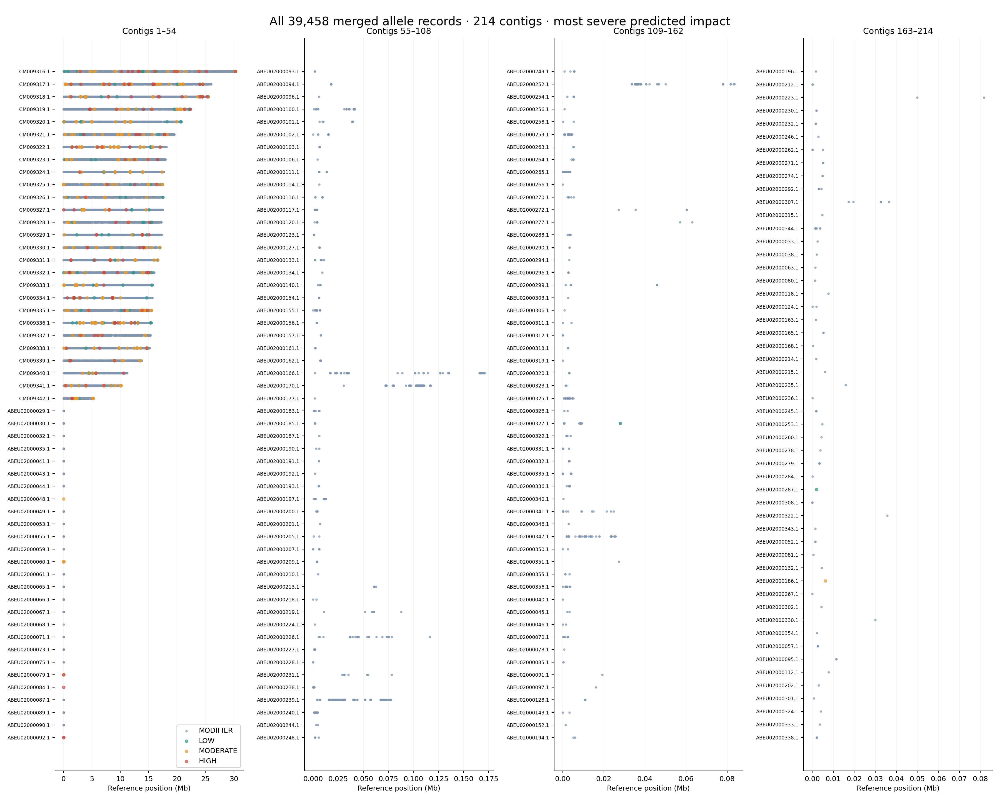

# What the five-sample results mean

Read this alongside the [measured results and genotype tables](README.md) and [whole-VCF analysis](results/WHOLE_VCF_ANALYSIS.md). These conclusions describe the analyzed 20-million-pair subsets, rather than every read available for each run.

## 1. What was actually merged?

Five independently filtered variant callsets were combined by allele identity against the same reference. The merged file has **39,458 allele records**, comprising **32,276 SNPs (81.8%)** and **7,182 indels (18.2%)**. A SNP replaces one reference nucleotide; an indel inserts or deletes sequence. A record is an allele at a reference coordinate, so counts should not be interpreted as counts of affected genes or necessarily distinct genomic positions.

The individual callsets contain 21,396, 22,438, 24,042, 24,009, and 23,655 records. Their sum is larger than 39,458 because shared alleles occupy one merged record with five sample columns. The analysis checked the exact union and the carried sample genotypes. It did not substitute a reference genotype where a sample lacked a filtered variant call.


CRIS1#1 has the largest retained callset, but a larger count alone does not show a larger mutation burden caused by editing. Coverage, alignment, starting material, and which calls pass filters can all affect these totals. With two controls and three differently labeled CRIS samples, these bars are a descriptive comparison rather than a replicated treatment-effect test.

## 2. Coverage and confidence

Approximately **96.2–96.5%** of reference bases have coverage under the stated mapping-quality definition, while mean depth is approximately **8.0–8.6×** over the entire reference. These are different measurements: breadth asks how much sequence is covered, and depth asks how many reads cover each base on average. Neither guarantees adequate coverage at a particular candidate.


The boxplots summarize retained variant sites. The median usable depth of 6–7 reads is not the same quantity as genome-wide average depth. A site can have raw coverage but fewer usable reads after quality filters. Original per-sample QUAL values are used in the candidate tables because a merged site-level value cannot express each sample's independent confidence.

At approximately 8× average depth, local sampling variation matters. An allele can pass in one sample and fail a threshold in another without proving that their underlying sequences differ. Coverage tracks in IGV can also autoscale separately; compare their printed numeric scales and DP values rather than bar heights alone.

## 3. Shared alleles and missing entries


**11,010 records (27.9%)** have retained alternate calls in all five samples. **11,676 records (29.6%)** appear in exactly one retained callset. The latter are candidates for further comparison, not confirmed sample-specific mutations: the other four entries are unknown in this variant-only merge.

In the call-pattern chart, `11111` means a retained call in every sample. `00100` means retained only in CRIS1#1, with unknown entries elsewhere. The order is Control#1, Control#2, CRIS1#1, CRIS1#2, CRIS2#1. Zero does not mean experimentally demonstrated absence or a confident reference genotype.

Jaccard overlap divides shared retained alleles by alleles retained in either member of a sample pair. The highest pair is CRIS1#1/CRIS1#2 at **0.609**; the CRIS pairs range from **0.595 to 0.609**, compared with **0.539** for the two controls. This is callset similarity, not 60.9% genome identity. Most genomic bases are not represented in these variant-only lists. This descriptive pattern can reflect common background as well as technical differences; no significance test or causal effect is established here.

## 4. Where the variants occur



The figure includes every record on all **214 reference contigs with calls**. Each contig has its own coordinate origin. The four panels use different horizontal scales so short contigs remain visible. Dense overlapping points do not reveal the exact number of variants at each location, so the [contig count table](results/contig_variant_counts.tsv) provides numerical totals and counts per megabase.

Counts per megabase divide by full reference length, rather than callable length. A dense region is therefore not automatically a biological mutation hotspot. Repeats, alignment ambiguity, transcript placement, and coverage differences need examination before making an enrichment claim.

## 5. Predicted effects


Each record is counted once by its most severe transcript annotation: **143 HIGH**, **1,001 MODERATE**, **708 LOW**, and **37,606 MODIFIER**. One variant may affect more than one transcript, so the full annotation table contains more rows than the VCF. These categories summarize predicted consequences relative to the chosen gene models; they are not measured changes in protein activity or phenotype.

HIGH calls are priorities for inspection, not automatically damaging or causal. Among HIGH records, 142 include protein-coding transcripts and one includes a pseudogene transcript. The pseudogene consequence should not be presented as an established functional protein change. MODIFIER often concerns noncoding context, and does not prove biological neutrality. The database used the matching reference/GFF but lacked separate CDS/protein FASTA validation, which limits confidence in model-dependent interpretations.

## 6. Annotated IGV evidence: how to read the boxes

These figures retain labeled rectangles on actual IGV screenshots, with explanations below each image. Original screenshots remain available. The rectangles mark the evidence discussed in the text. Their coordinates are recorded in [the overlay manifest](provenance/igv-callout-coordinates.json).

### Example 1: insertion and predicted frameshift


**A — Genotype column:** The selected insertion appears in all five sample rows. **B — Read evidence:** The tall rectangle follows the insertion coordinate through all five BAMs. Compare insertion indicators with the usable AD/DP counts below. **C — Reference and transcript context:** The lower rectangle marks the reference sequence and nearby models used to interpret the coding consequence.

Pink/purple read backgrounds indicate strand. The insertion markers identify the sequence event; their placement should be assessed with the local alignment and saved pileups. The rectangles are added to the original screenshot, whose underlying read data remain unchanged.

[Original screenshot](png/06_candidate_1.png). The exact allele is **CM009329.1:15,055,010 A>AT**. The A anchors a one-base T insertion. The box follows the insertion position through all five samples; insertion indicators provide a visual cue, and the read-count table supplies the quantitative evidence.

The usable ALT counts are **8, 9, 8, 12, and 7**, with zero reference-supporting reads in these filtered AD fields. In the haploid calling model, GT `1` means the alternate allele. This does not claim every raw read is alternate: usable DP/AD reflect filtering, while the displayed alignment view can include a different set of reads.

For transcript `Pp3c14_23500V3.1`, the annotation is `c.2411_2412insT`, `p.Glu804fs`, in gene `PHYPA_018940`. Inserting one coding base changes the downstream reading frame in this model. The annotation does not independently verify expression, a resulting protein product, or a phenotype. All five samples, including both controls, carry the call; it is not a demonstrated CRIS-specific lesion. The hypothetical-protein description supplies no experimentally established biochemical role.

### Example 2: nucleotide replacement and predicted amino-acid change


**A — Genotype column:** The selected A>G call is shown across five sample rows. **B — Read evidence:** The vertical rectangle follows this coordinate through the five BAM tracks; nearby mismatch columns represent separate positions. **C — Reference and transcript context:** The lower rectangle identifies the sequence and transcript model relevant to the predicted amino-acid substitution.

Pink/purple backgrounds encode read strand, while colored bases identify mismatches. Use the AD/DP counts below to quantify support. Both controls and all three CRIS samples retain this allele; the image does not establish an editing-specific effect. The boxes are presentation annotations on the original IGV output.

[Original screenshot](png/06_candidate_2.png). At **CM009330.1:8,424,047 A>G**, the rectangle isolates the selected mismatch column. Several nearby colored columns occur in this close-up; the selected A>G allele is the boxed coordinate, and neighboring substitutions must be interpreted as separate records.

Usable ALT counts are **11, 11, 13, 16, and 18**, again with zero reference counts in the filtered AD fields. The predicted effect is `c.2263A>G`, `p.Lys755Glu`, in `PHYPA_019678`, transcript `Pp3c15_12700V3.1`. Lysine-to-glutamate changes the predicted amino acid, but the MODERATE label alone cannot establish loss or gain of function. Read backgrounds indicate strand; the colored mismatch base identifies the nucleotide difference. Both controls carry this allele, so the image does not establish editing specificity.

### Example 3: coding replacement without a predicted amino-acid change


**A — Genotype column:** The boxed T>C call appears in all five sample rows. **B — Read evidence:** The tall rectangle follows the mismatch position across the five alignments. **C — Reference and transcript context:** The lower rectangle marks the reference and model used to assign the synonymous consequence.

Pink/purple read backgrounds indicate strand. Compare the colored base column with the AD/DP values below, especially the lower usable support in Control#1. The allele is retained in both controls and all three CRIS samples, so it does not distinguish the groups. Rectangles are added to the original IGV screenshot without altering the underlying data.

[Original screenshot](png/06_candidate_3.png). The selected **CM009317.1:11,828,535 T>C** is predicted as `c.510T>C`, `p.Leu170Leu`, in gene `PHYPA_002866`, transcript `Pp3c2_18051V3.1`. The codon changes while the predicted amino acid remains leucine, which explains the LOW synonymous classification.

Usable ALT counts are **4, 9, 8, 8, and 12**. Control#1 has weaker usable read support than the other samples; the call remains present but the figure should not imply equal confidence across samples. A synonymous classification does not experimentally exclude effects on splicing, transcript behavior, or other biology. All five samples carry the retained allele.

## 7. What would make a treatment-specific conclusion stronger?

Genotype the union sites in every BAM under a shared procedure and define a consistent callable-site mask. Require adequate sample-level depth and quality before comparing alternate and reference states. Review support on both read directions, read placement, neighboring indels/repeats, and local coverage for shortlisted loci. This is particularly important for single-callset records currently missing in other samples.

Only then prioritize consistent group differences for functional annotation, appropriate replicated comparisons, and independent validation. These results establish a reproducible merged dataset, predicted effects, and visible read evidence at selected loci. They do not yet establish which variants were caused by CRISPR or caused a phenotype.

## Reproduce the annotations

```bash
python scripts/annotate_igv.py
```

Run in the plotting environment after the original IGV snapshots exist. The [source](scripts/annotate_igv.py) writes separate labeled images and a pixel-coordinate manifest. `make report` includes this step. Full processing commands are in the [chronological code guide](CODE_GUIDE.md).
