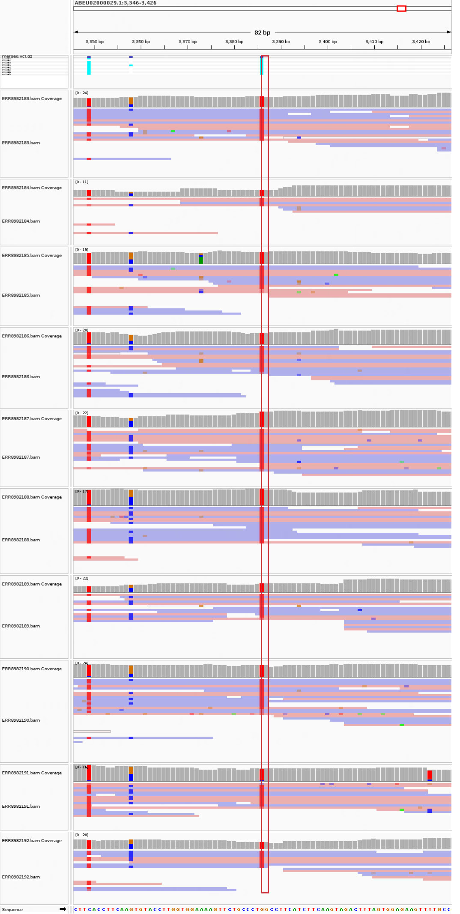
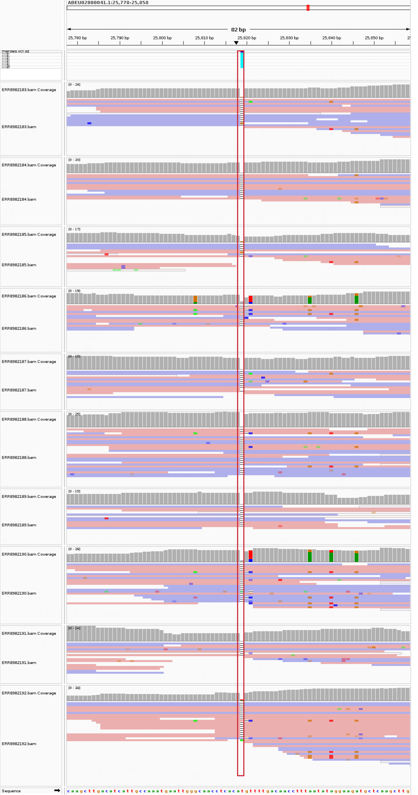
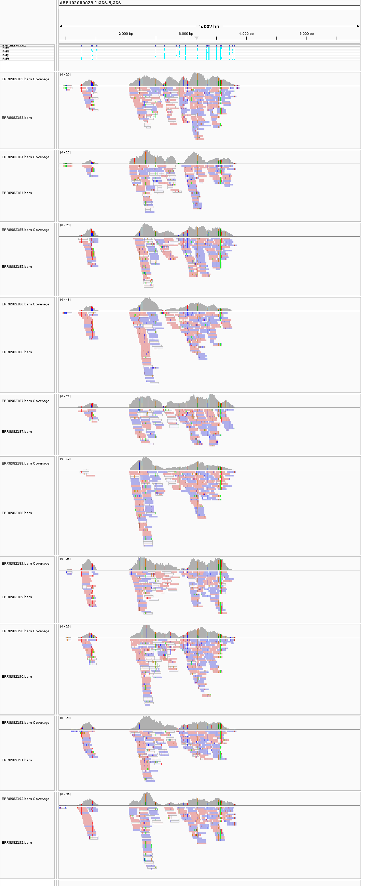

# Assignment 9

This workflow calls variants for ten *Physcomitrium patens* samples from study PRJEB51295. Each sample uses 20 million read pairs.

## Findings

The merged VCF contains **47,442 variant records**: **38,682 SNPs** and **8,760 indels**. **7,833 records** have retained calls in all ten samples. The sample results and IGV evidence are shown below.

## Coverage and retained calls

| Sample | Label | Retained records | Mean reference depth | Reference covered |
|---|---|---:|---:|---:|
| ERR8982183 | Control#1 | 21,396 | 8.03× | 96.19% |
| ERR8982184 | Control#2 | 22,438 | 8.23× | 96.28% |
| ERR8982185 | CRIS1#1 | 24,042 | 8.42× | 96.48% |
| ERR8982186 | CRIS1#2 | 24,009 | 8.57× | 96.24% |
| ERR8982187 | CRIS2#1 | 23,655 | 8.07× | 96.38% |
| ERR8982188 | CRIS2#2 | 23,461 | 8.33× | 96.25% |
| ERR8982189 | PEG#1 | 21,061 | 7.82× | 95.89% |
| ERR8982190 | PEG#2 | 22,660 | 8.44× | 96.56% |
| ERR8982191 | PEG-DNA#1 | 22,691 | 8.73× | 96.42% |
| ERR8982192 | TAL#1 | 23,364 | 8.39× | 96.20% |

Coverage uses `samtools coverage -q 20 -Q 0`, divided by the entire reference length, including uncovered sequence. Mean depth and coverage breadth describe different properties; neither guarantees adequate depth at every site. Call counts are affected by depth, alignment, and filtering as well as biology.

## IGV read evidence

All ten BAMs and the merged VCF are loaded against the same reference. Each BAM track is named by its run accession. The red rectangle follows the selected reference position through the genotype rows and read tracks. Pink/purple read backgrounds encode strand; colored bases and indel markers indicate sequence differences. Explanations appear below each image.

### Example 1: ABEU02000029.1:3,386 G>T



This SNP has retained calls in **10/10 samples**. Read support is shown below. GT `1` is an alternate haploid call; DP is usable read depth; AD lists reference and alternate read counts.

| Sample | Label | GT | Usable DP | AD (REF,ALT) | Quality-filtered BAM depth |
|---|---|---|---:|---|---:|
| ERR8982183 | Control#1 | `1` | 10 | `0,10` | 13 |
| ERR8982184 | Control#2 | `1` | 3 | `0,3` | 4 |
| ERR8982185 | CRIS1#1 | `1` | 11 | `0,11` | 11 |
| ERR8982186 | CRIS1#2 | `1` | 11 | `0,11` | 11 |
| ERR8982187 | CRIS2#1 | `1` | 15 | `0,15` | 18 |
| ERR8982188 | CRIS2#2 | `1` | 12 | `0,12` | 17 |
| ERR8982189 | PEG#1 | `1` | 9 | `0,9` | 10 |
| ERR8982190 | PEG#2 | `1` | 11 | `0,11` | 14 |
| ERR8982191 | PEG-DNA#1 | `1` | 8 | `0,8` | 10 |
| ERR8982192 | TAL#1 | `1` | 8 | `0,8` | 8 |

Both controls and all treatment groups carry this variant. It is a shared difference from the reference, not evidence that editing caused it.

DP and AD come from the variant caller. BAM depth uses base and mapping quality >=20; different read filters can produce different depths.

### Example 2: ABEU02000041.1:25,818 AT>A



This deletion removes the T after the retained A anchor (AT>A). It has retained calls in **10/10 samples**. Read support is shown below. GT `1` is an alternate haploid call; DP is usable read depth; AD lists reference and alternate read counts.

| Sample | Label | GT | Usable DP | AD (REF,ALT) | Quality-filtered BAM depth |
|---|---|---|---:|---|---:|
| ERR8982183 | Control#1 | `1` | 8 | `0,8` | 8 |
| ERR8982184 | Control#2 | `1` | 8 | `0,8` | 13 |
| ERR8982185 | CRIS1#1 | `1` | 3 | `0,3` | 5 |
| ERR8982186 | CRIS1#2 | `1` | 8 | `3,5` | 9 |
| ERR8982187 | CRIS2#1 | `1` | 8 | `1,7` | 7 |
| ERR8982188 | CRIS2#2 | `1` | 15 | `3,12` | 20 |
| ERR8982189 | PEG#1 | `1` | 7 | `0,7` | 6 |
| ERR8982190 | PEG#2 | `1` | 14 | `1,13` | 13 |
| ERR8982191 | PEG-DNA#1 | `1` | 3 | `0,3` | 4 |
| ERR8982192 | TAL#1 | `1` | 15 | `1,14` | 17 |

Both controls and all treatment groups carry this variant. It is a shared difference from the reference, not evidence that editing caused it.

DP and AD come from the variant caller. BAM depth uses base and mapping quality >=20; different read filters can produce different depths.

## Regional context



This 5-kb window surrounds the SNP example. Inspect coverage continuity and local read placement before interpreting a variant. Tracks can autoscale independently, so compare their numeric scales rather than apparent bar heights alone.

## Interpretation limits

This is a selected, unbalanced subset of an editing-specificity study. Prefix sampling is deterministic rather than random. Moderate coverage can miss variants, and variant-only merging does not establish which alleles are absent. Common-site genotyping and comparable callable regions are needed before testing group differences. The original study conclusions are context, not conclusions independently established by this exercise.

## 1. Design file

`design.csv` contains sample IDs, labels, groups, BioSamples, paired FASTQ links, file sizes, read-pair limits, ploidy, and alignment settings for ERR8982183–ERR8982192. Each sample uses 20 million read pairs and the Phypa V3 reference (GCA_000002425.2). Variants are called as haploid.

## 2. Run the Makefile

Use Linux/WSL with the course bioinfo environment active. Install **cutadapt 5.2** first. The Makefile does not install tools. A full run needs about 150 GB of free space and several hours.

```bash
git clone https://github.com/Bismarkacquah/BMB852.git
cd BMB852/Week-9
make check
make samples
make -j2 batch THREADS=3
```

This runs two samples at a time with three threads each. The Makefile downloads the data, trims and aligns reads, calls variants, and merges the VCFs. Repeat the command to reuse completed files. No files from earlier weeks are needed.

For a small trial run before the full analysis:

```bash
make smoke
```

This uses 10,000 read pairs per sample and writes to `output-smoke/`; its counts will differ from the full analysis.

## 3. Check the output

```bash
ls output/merged.vcf.gz output/merged.vcf.gz.csi
cat output/validation.json
cat output/summary.tsv
```

The saved full run has ten samples and 47,442 merged records. Validation should report `true` for both allele-union and genotype checks; exact counts can vary with tool versions. Saved full-run files are in `results/`; new runs write to `output/`.

To run the full analysis in a new output directory:

```bash
make -j2 batch OUT=output-fresh THREADS=3
```

To regenerate the IGV figures after the full batch, additionally provide **IGV 2.19.8**, **Java 21 with a working display**, and **matplotlib 3.10.8**:

```bash
export IGV_DIR=/absolute/path/to/IGV_Linux_2.19.8
make report THREADS=3 PLOT_PYTHON=python3
```

Set `PLOT_PYTHON` to an interpreter with matplotlib. Use the same `OUT` value as the batch when regenerating figures from another output directory.
