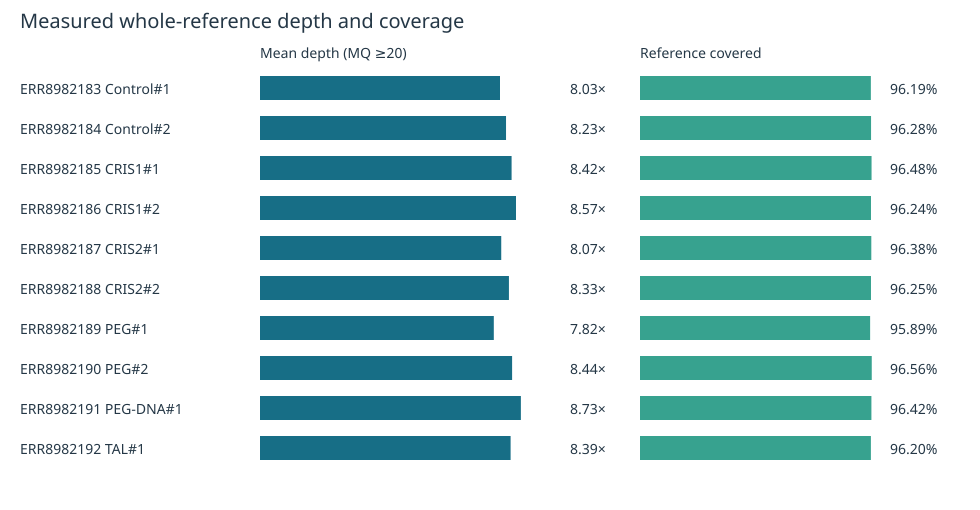

# Week 9 assignment

## Project and design

[PRJEB51295](https://www.ebi.ac.uk/ena/browser/view/PRJEB51295) investigates genome-wide specificity of CRISPR-Cas9 and TALEN editing in *Physcomitrium patens*. The archive contains 14 runs. This analysis selects ten: two controls, four CRIS-labelled samples, two PEG samples, one PEG-DNA sample, and one TAL-labelled sample. These are an unbalanced subset, not a complete replication of the original study.

The [design.csv](design.csv) records sample labels, BioSamples, paired FASTQ URLs and sizes, read-pair counts, and ploidy. All samples use the same Week 7 reference, **GCA_000002425.2 (Phypa V3)**, and **20 million read pairs each**. Haploid calling is an explicit assumption.

## Reproduce

Use Linux/WSL with the existing bioinfo environment active. Additional prerequisites are **cutadapt 5.2**, **IGV 2.19.8 with Java 21 and a working display**, and **matplotlib 3.10.8** for boxed screenshots. Install prerequisites yourself; the workflow installs no software. Allow roughly 150 GB of free space and hours of processing for a fresh ten-sample run.

```bash
git clone https://github.com/Bismarkacquah/BMB852.git
cd BMB852/Week-9
make check
make samples
make -j2 batch THREADS=3
```

All ten samples, **ERR8982183 through ERR8982192**, are already in `design.csv` at 20 million read pairs each. No manual sample selection or earlier-week files are needed. Plain `make` also runs and merges all ten. Use `make sample SAMPLE=ERR8982185 THREADS=3` for the original Week 7 sample, or `make help` for available commands.

Optional figure regeneration after the batch finishes:

```bash
export IGV_DIR=/absolute/path/to/IGV_Linux_2.19.8
make report THREADS=3 PLOT_PYTHON=python3
```

`sample` calls variants for one design row; `batch` processes every row and merges the VCFs. `report` measures coverage, regenerates IGV screenshots, and writes this report using paths from your checkout. Set `PLOT_PYTHON` to an existing interpreter with matplotlib. Two samples can run concurrently; use `make batch THREADS=3` for serial sample processing.

The workflow downloads and checks the reference, indexes it, verifies synchronized read subsets, trims adapters/low-quality ends, aligns reads, calls and normalizes variants, and retains QUAL ≥20 and DP ≥3. Logs and manifests are under `output/SAMPLE/`. The merged VCF is `output/merged.vcf.gz`; validation is `output/validation.json`. Repeating the commands reuses completed targets. Edit the CSV or use `DESIGN=other.csv OUT=other_output` to change the input design.

## Findings

- **47,442 merged allele records** across ten samples: 38,682 SNPs and 8,760 indels. Other record types: 0.
- Measured mean reference depths range from **7.82× to 8.73×**, with **95.89–96.56%** of the full reference covered at mapping quality ≥20. This supports variant detection while leaving local low-depth uncertainty.
- **7,833 records** have retained calls in all ten samples. Missing calls remain unknown. Neither shared variants nor unequal call counts establish editing-induced mutations.



See [IGV findings and read-support tables](FINDINGS.md), [per-sample counts](results/summary.tsv), [merged VCF](results/merged.vcf.gz), and [validation](results/validation.json). The [10,000-pair smoke test](results/smoke/) is archived separately and is not the biological analysis. `make smoke` checks the short computational path only.

Study metadata and reuse records are in [provenance](provenance/README.md). The selected subset and moderate coverage do not support reproducing the original study’s off-target conclusions without common-site genotyping, callable-site filtering, and appropriate controls.
